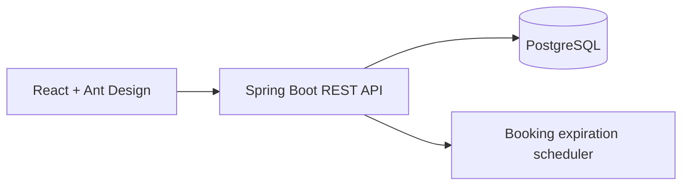

# Kiến trúc hệ thống hiện tại

HANBAY HOTEL là modular monolith gồm React client, Spring Boot REST API và PostgreSQL. Flyway là nguồn sự thật duy nhất của schema.

## Backend package-by-feature

- `authentication`: register, login, JWT, refresh token, role và session model.
- `room`: room type, physical room và availability.
- `booking`: pending booking, danh sách booking theo tài khoản, guest, add-on snapshot, booking night và expiration.
- `payment`: tạo/tra cứu payment, sinh QR SePay, tiếp nhận webhook và màn hình giám sát payment/webhook cho nhân sự.
- `pricing`: price rule và tính giá từng đêm.
- `addon`: catalog dịch vụ bổ sung.
- `user`: user model/repository dùng chung cho authentication và booking.
- `common`: response envelope, exception, security và cấu hình hạ tầng dùng chung.

Webhook SePay xác thực API key, chống lưu trùng theo `id` giao dịch, lưu payload vào PostgreSQL, đối soát payment code và cộng dồn số tiền nhận. Khi nhận đủ tiền, payment chuyển `SUCCESS`; booking `PENDING` còn hiệu lực chuyển `CONFIRMED`. Nếu booking không còn hiệu lực hoặc payment trước đó đã `CANCELLED`/`FAILED`/`EXPIRED`, mọi giao dịch đến trễ đều tạo refund `PENDING` theo từng event, kể cả khi số tiền nhỏ hơn payment amount. Check-in/check-out và housekeeping không thuộc flow webhook.

## Frontend feature structure

- `authentication`: login, registration, refresh token và auth provider.
- `room`: catalog và tìm hạng phòng còn trống.
- `booking`: nhập khách, chọn dịch vụ theo quantity, tạo/cập nhật PENDING, review và khu vực booking của tài khoản.
- `home`, `dashboard`: shell hiện tại.

Ưu tiên Ant Design component và design token; CSS chỉ hỗ trợ layout đặc thù.

## Account và authorization

Khách có account thật nhưng không có staff role. Staff role hợp lệ: `ADMIN`, `MANAGER`, `RECEPTIONIST`, `HOUSEKEEPER`. Khu vực booking của khách dùng authenticated route riêng; dashboard nhân sự dùng role guard.

## Booking hiện tại

1. Guest tìm room type theo ngày và occupancy.
2. Backend trả availability cùng dynamic nightly price breakdown.
3. Guest khai báo adults/children; trẻ `<= 12` được khai báo là child và miễn phụ thu tiền phòng trong MVP.
4. Backend kiểm tra adult capacity, child capacity và max guests.
5. Guest chọn add-on và quantity.
6. Backend lấy catalog price hiện tại, validate active/quantity và snapshot `quantity`, `unit_price`, `total_price`.
7. Booking PENDING giữ inventory 15 phút; có thể cập nhật và tính lại khi còn hạn.
8. Scheduler chuyển booking quá hạn sang EXPIRED.

Add-on dùng snapshot tại thời điểm transaction tạo/cập nhật booking đọc catalog. Booking cũ không bị thay đổi khi Manager sửa giá hoặc deactivate add-on. Contract hiện tại chưa định nghĩa việc khóa catalog xuyên suốt một thay đổi đồng thời; đây là ranh giới nghiệp vụ cần chốt nếu yêu cầu một thứ tự tuyệt đối giữa thao tác quản trị và tạo booking.

Flow hiện tại là `webhook RECEIVED -> đối soát payment -> cộng dồn giao dịch -> payment SUCCESS -> booking CONFIRMED`. Với late payment, nhánh cuối thay bằng `refund PENDING`; với overpayment, booking vẫn được xác nhận và phần chênh lệch tạo refund `PENDING`. Response `200` xác nhận webhook đã được xử lý an toàn; client đọc API payment status để biết kết quả nghiệp vụ.

## Concurrency

Tạo booking khóa room type, kiểm tra lại inventory trong transaction và tính cả PENDING chưa hết hạn. Cập nhật booking khóa booking và loại chính booking đó khỏi phép đếm overlap.

Housekeeping khóa pessimistic phòng trước mỗi transition `DIRTY -> CLEANING -> AVAILABLE`; hai yêu cầu start đồng thời chỉ một yêu cầu thành công.

## Phạm vi triển khai theo vai trò

- Guest đã đăng nhập có lịch sử và trang chi tiết booking của chính mình; nhân viên không dùng route này. Guest ẩn danh chỉ tra cứu payment bằng booking access token lưu trong `sessionStorage`, nên không thể khôi phục token khi đổi trình duyệt hoặc kết thúc phiên.
- Receptionist có check-in/check-out vận hành. Check-out chỉ hoàn tất khi số dư bằng `0`; hệ thống chưa có contract thu tiền mặt/POS tại quầy và không giả lập thanh toán.
- Manager đã có dashboard report, payment monitoring, refund monitoring, add-on management, price-rule management và quyền quản lý bảo trì phòng. Admin dùng các endpoint ghi rõ `ADMIN` như dashboard, payment monitoring/raw webhook, add-on management và price-rule management; maintenance/refund UI hiện chỉ dành cho Manager.
- Quản lý price rule trong FR-13 có contract tại `/api/v1/management/price-rules`; thay đổi chỉ ảnh hưởng lần tính giá/booking mới và dùng deactivate thay hard-delete. CRUD room type, physical room và thay đổi base price vẫn chưa có contract nghiệp vụ đầy đủ (đặc biệt quy tắc xóa và ảnh hưởng dữ liệu tham chiếu), nên chưa được công bố/triển khai.
- Admin không có bộ CRUD riêng được suy ra từ tên `/admin`; quyền Admin chỉ được cấp rõ trên từng API đã công bố.
# Unified Hotel AI Assistant

`POST /api/v1/ai/chat/stream` là conversational entry point duy nhất. `HotelAiAssistantService`
quản lý conversation context và cho model chọn giữa normal chat, tám read-only business tools và
`search_hotel_policy`. Policy tool dùng OpenAI `text-embedding-3-small` (1536 chiều) với Spring AI
`PgVectorStore` cosine similarity search (`topK=3`, threshold `0.18`) trên PostgreSQL/pgvector.
Evidence được trả cho model dưới dạng untrusted reference data và citations được phát bằng SSE.
Canonical input là các file `*-policy.md` trong `docs/knowledge-base`; Maven đóng gói trực tiếp
chúng vào classpath. Index được ingest theo checksum khi application production khởi động.

Vector và metadata được persist trong `policy_vector_store`; HNSW index dùng cosine distance.
`policy_knowledge_ingestion` lưu checksum corpus để restart không embedding lại dữ liệu không đổi.
Không có tool mutation. Endpoint `POST /api/v1/ai/room-maintenance/interpret` vẫn tách biệt vì chỉ
interpret structured intent cho Manager; thay đổi room yêu cầu confirmation và REST API riêng.
