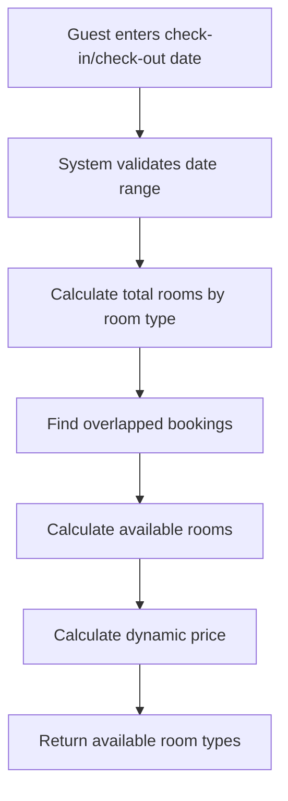
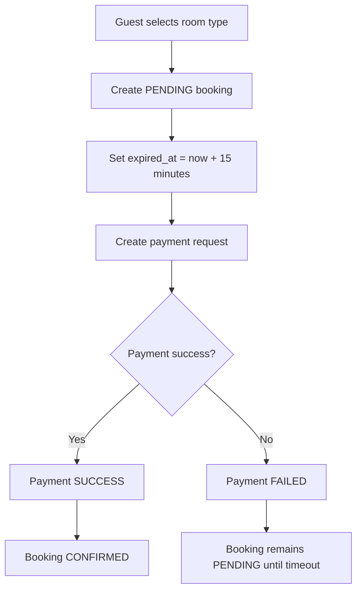
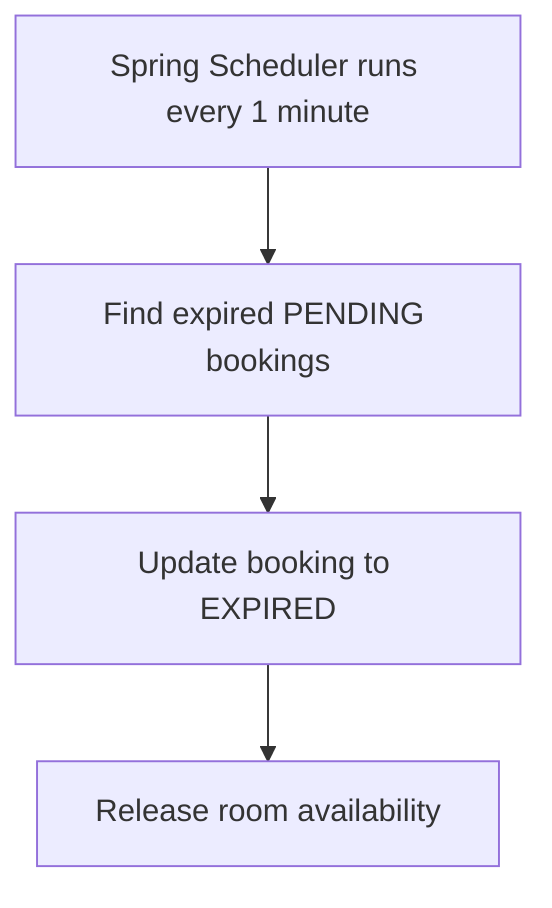
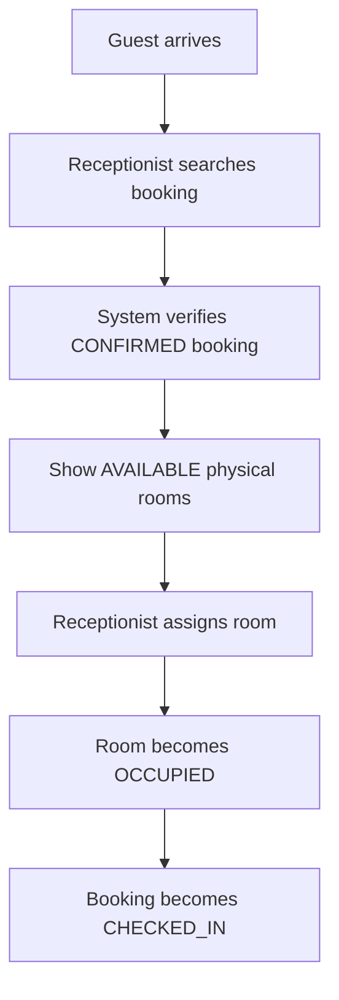
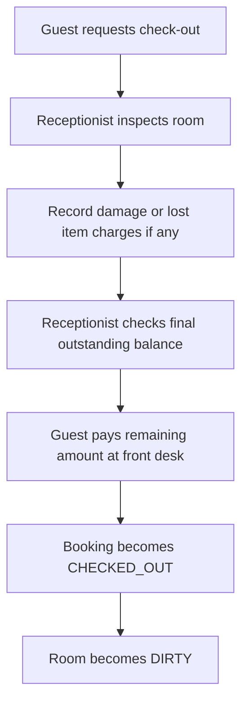
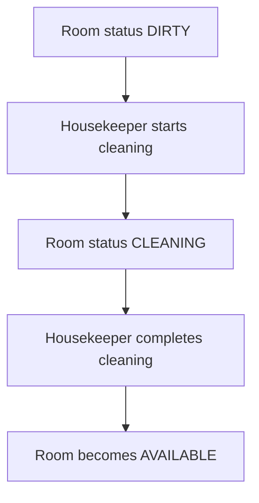
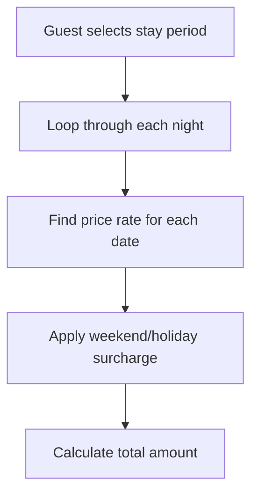
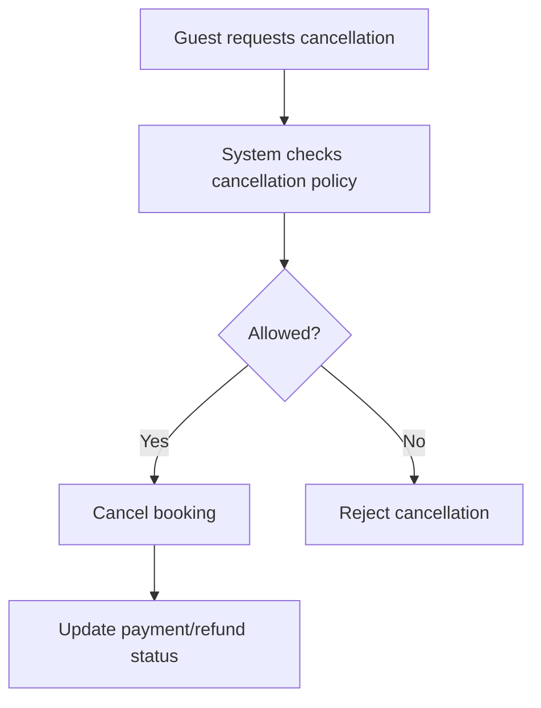

# 07. Business Workflows

# HANBAY HOTEL
## Business Workflow Document

---

# 1. Room Search Flow

---

# 2. Booking & Payment Flow

---

# 3. Booking Expiration Flow

---

# 4. Check-in Flow

---

# 5. Check-out Flow

---

# 6. Housekeeping Flow

Trong MVP, `CHECKED_OUT` là trạng thái kết thúc của booking; không có trạng thái
`COMPLETED` riêng. Check-out chỉ được thực hiện sau khi backend ghi nhận công nợ
cuối cùng bằng `0`. Lễ tân có thể ghi nhận phí phát sinh/đền bù sau khi kiểm tra
phòng và số tiền thu thêm tại quầy trong request check-out; hệ thống chưa tích
hợp máy POS hoặc nhà cung cấp thanh toán riêng cho khoản thu tại quầy. Khoản thu tiền mặt
được lưu thành chứng từ `CASH-…` với giao dịch `PAYMENT / SUCCESS`, người thu và thời điểm thu.
Số tiền thực nhận không vượt công nợ sau khi cộng phí đền bù. Webhook và checkout cùng khóa
booking trước khi cập nhật số tiền đã trả; gửi checkout trùng không tạo thêm khoản thu.

---

# 7. Dynamic Pricing Flow

---

# 8. Cancellation Flow

# 9. Trả phòng sớm và gia hạn lưu trú

Trả phòng sớm khóa booking và phòng, tính khoản hoàn từ snapshot từng đêm. Phí hư hỏng/phát sinh và công nợ được bù trừ vào khoản hoàn; nếu còn phải thu thì lễ tân chỉ được thu đúng phần chênh lệch tại quầy. Khi có khoản hoàn, hệ thống tạo yêu cầu chuyển khoản `PENDING`; sau đó atomically chuyển booking sang `CHECKED_OUT` và phòng sang `DIRTY`. Gia hạn khóa booking, rồi khóa hạng phòng và phòng đã gán (nếu có); hệ thống kiểm tra lại khả dụng trước khi lưu các snapshot và tổng tiền mới.
