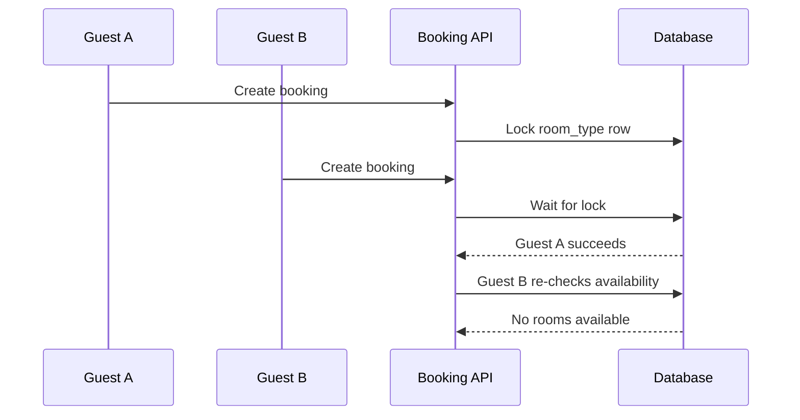

# 08. Concurrency Design

# HANBAY HOTEL
## Concurrency & Consistency Design

---

# 1. Problem Statement

Hotel booking systems must prevent overbooking when multiple guests book the same room type at the same time.

Example:

- Deluxe room type has only 1 available room.
- Guest A and Guest B submit booking at nearly the same time.
- Only one booking must be confirmed.

---

# 2. Availability Calculation

The system does not rely only on current physical room status.

Availability formula:

```text
available_rooms = total_physical_rooms - overlapped_bookings
```

Overlap condition:

```sql
booking.check_in_date < :requestedCheckOut
AND booking.check_out_date > :requestedCheckIn
```

Counted booking statuses:

```text
PENDING not expired
CONFIRMED
CHECKED_IN
```

---

# 3. Pessimistic Locking Strategy

For critical booking confirmation, the system uses pessimistic lock to avoid race condition.

Example repository method:

```java
@Lock(LockModeType.PESSIMISTIC_WRITE)
@Query("select rt from RoomType rt where rt.id = :id")
Optional<RoomType> findByIdForUpdate(UUID id);
```

Flow:



---

# 4. Booking Hold

When booking is created:

```text
status = PENDING
expired_at = now + 15 minutes
```

Pending booking is counted as held inventory until expired.

---

# 5. Booking Expiration

A Spring Scheduler runs periodically:

```java
@Scheduled(fixedRate = 60000)
public void expirePendingBookings() {
    // find PENDING bookings where expired_at < now
    // update status to EXPIRED
}
```

---

# 6. Payment Webhook Idempotency

Payment gateway may call webhook more than once.

The system must ensure:

- Mỗi `id` SePay chỉ tạo một `payment_webhook_event` nhờ `deduplication_key` duy nhất.
- Webhook trùng được trả `200` mà không lưu lại nếu bản ghi đã tồn tại.
- Consumer đối soát payment code, cộng dồn transaction thành công và xác nhận booking còn hiệu lực khi đã nhận đủ tiền. Late payment cho booking hết hiệu lực hoặc payment `CANCELLED`/`FAILED` được đối soát thành `SUCCESS` và tạo refund `PENDING` thay vì xác nhận booking.

Flow lấy PostgreSQL advisory transaction lock theo deduplication key trước khi kiểm tra và `INSERT`. Hai request cùng `id` đến đồng thời được tuần tự hóa; request sau thấy event đã tồn tại và được ACK như callback trùng. Unique constraint vẫn là lớp bảo vệ dữ liệu cuối cùng.

Constraint hiện có:

```text
payment_webhook_events.deduplication_key UNIQUE
```

---

# 7. Transaction Boundary

Critical operations must be inside transaction:

- Create booking
- Confirm payment
- Assign room
- Check-in
- Check-out
- Cancel booking

---

# 8. Failure Scenarios

| Scenario | Handling |
|---------|----------|
| Two guests book same room | Pessimistic lock |
| Payment webhook trùng tuần tự | Kiểm tra `deduplication_key`, không lưu thêm và trả `200` |
| Payment webhook trùng đồng thời | Advisory transaction lock tuần tự hóa xử lý; request sau được ACK `200` |
| Booking expired before payment | Không xác nhận booking; mọi khoản chuyển trễ, kể cả chuyển thiếu, đều tạo refund `PENDING` theo từng event |
| Tổng tiền nhận vượt payment amount | Xác nhận booking và tạo refund `PENDING` cho phần chênh lệch |
| Room assigned twice | Lock room row |
| Check-in invalid status | Reject state transition |

---

# 9. Demo Scenario

Steps:

1. Set Deluxe room total = 1.
2. Open two browser sessions.
3. Submit booking at the same time.
4. One request succeeds.
5. The other receives:

```json
{
  "success": false,
  "message": "Room is no longer available",
  "code": "BOOKING_001"
}
```
# Stay modification locking

- Early and normal checkout serialize on the booking row, then lock the assigned room.
- Extension locks booking, room type, then assigned room. Availability is rechecked in the transaction.
- Refund keys distinguish `booking-cancellation:{bookingId}` and `early-checkout:{bookingId}`; the unique database constraint is the retry backstop.
