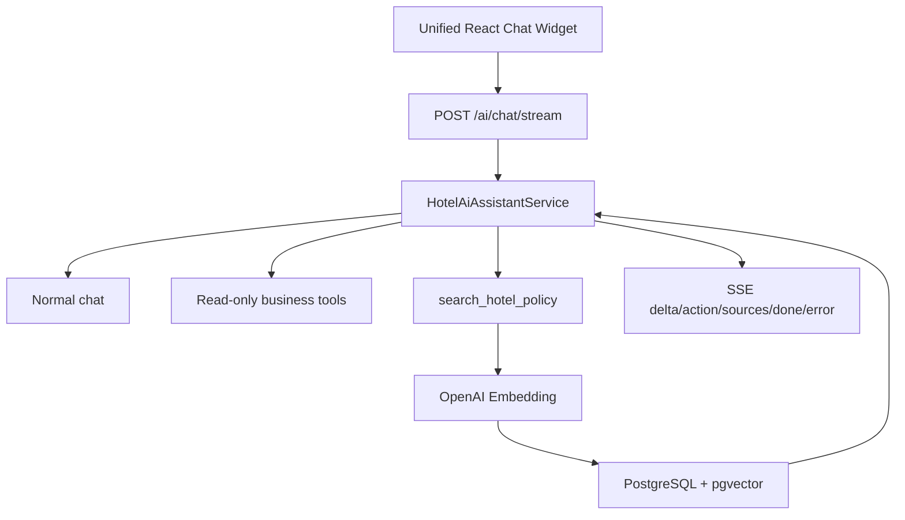

# 09. AI Integration

# HANBAY HOTEL
## Spring AI Integration Design

---

# 1. AI Goals

AI is used as an assistant, not as the main booking engine.

AI features:

- Unified Hotel AI Assistant
- Booking Summary
- Admin Insight Summary

---

# 2. AI Room Recommendation

User input:

```text
Family of 4, staying for 3 nights, wants quiet room, budget around 4 million VND.
```

System context:

- Available room types
- Capacity
- Price
- Amenities
- Policies

Expected output:

```json
{
  "recommendedRoomType": "Family Room",
  "reason": "Suitable for 4 guests and within budget",
  "estimatedPrice": 3900000
}
```

---

# 3. Policy RAG inside Unified Chat

User questions:

```text
Can I cancel my booking?
What time is check-in?
Are pets allowed?
```

AI answers based on predefined hotel policies.

Policy search là tool nội bộ của unified assistant, không phải assistant/endpoint độc lập:
canonical Markdown được chunk theo section, embedded bằng OpenAI `text-embedding-3-small`
(1536 chiều), persist trong PostgreSQL/pgvector qua Spring AI `PgVectorStore`, rồi semantic-retrieve
bằng cosine similarity trước khi gọi chat model.

---

# 4. Architecture



---

# 5. Prompt Strategy

The system prompt should:

- Keep answer short and clear.
- Use only hotel data provided by backend.
- Avoid making unsupported claims.
- Recommend user to contact receptionist when uncertain.

---

# 6. Spring AI Components

- ChatClient
- PromptTemplate
- Structured Output
- AI Request Logging

## Function Calling API

Backend exposes authenticated endpoints. The frontend uses the SSE endpoint so users see the answer as it is generated:

```http
POST /api/v1/ai/chat/stream
Authorization: Bearer <access-token>
Accept: text/event-stream
Content-Type: application/json
```

The stream emits `delta`, `action`, `sources`, `done`, or `error` events. Đây là conversational
endpoint duy nhất. AI concierge là floating widget duy nhất; unauthenticated users được yêu cầu
đăng nhập. Frontend chuẩn hóa malformed, empty và partial stream thành application error.

Production Policy RAG dùng OpenAI embedding và cần các biến môi trường sau. Local mặc định tắt RAG
(`AI_POLICY_RAG_ENABLED=false`); policy tool trả no-evidence an toàn, không dùng fake embedding:

```text
AI_POLICY_RAG_ENABLED=true
AI_EMBEDDING_MODEL=openai
OPENAI_API_KEY=<secret>
OPENAI_EMBEDDING_MODEL=text-embedding-3-small
OPENAI_EMBEDDING_DIMENSIONS=1536
```

Available read-only tools:

- `search_available_rooms`
- `calculate_stay_price`
- `get_room_type_details`
- `list_active_addons`
- `get_my_bookings`
- `get_booking_details`
- `get_payment_status`
- `check_cancellation_eligibility`

Booking and payment tools use the authenticated user's security context. The model cannot supply a user ID or booking access token.
`search_hotel_policy` coi mọi retrieved content là untrusted reference data; embedded instructions
không được thực thi. Khi không có evidence, model phải trả lời không tìm thấy policy thay vì dùng
kiến thức nền.

---

# 7. AI Request Logging

Table:

```text
ai_requests
- id
- user_id
- feature
- prompt (`[REDACTED]`)
- response (`NULL`)
- created_at
```

Purpose:

- Track success/failure, feature and duration without persisting raw user/provider content

---

# 8. Limitations

- AI does not create booking automatically.
- AI does not process payment.
- AI does not override hotel policy.
- AI answers are advisory only.

---

# 9. Future Enhancements

- Đánh giá/tuning threshold bằng tập câu hỏi production lớn hơn corpus demo
- Review summary
- Revenue insight assistant
- Multilingual support
