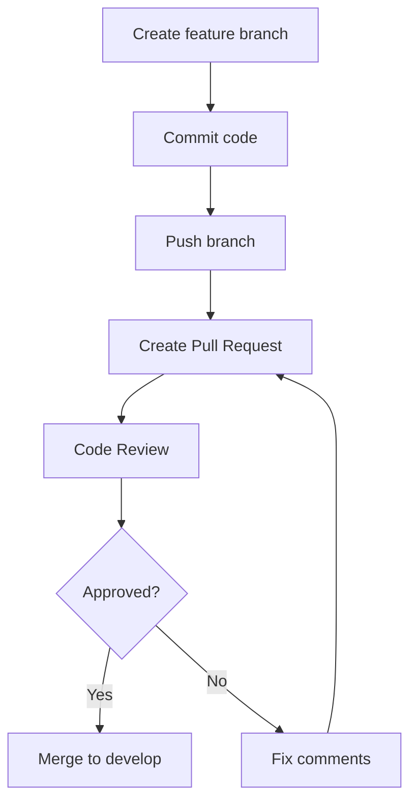

# 13. Git Workflow

# HANBAY HOTEL
## Git Workflow Guide

---

# 1. Branching Strategy

```text
main
  ↑
develop
  ↑
feature/*| bugfix/* | docs/*
```

Branches:

```text
main        production-ready code
develop     integration branch
feature/*   individual feature
bugfix/*    bug fixing
hotfix/*    urgent fix
docs/*      documentation
```

---

# 2. Branch Naming

```text
feature/HAN-16-guest-registration
bugfix/HAN-45-invalid-room-price
hotfix/HAN-90-payment-crash
docs/HAN-15-git-workflow
```

---

# 3. Commit Convention

```text
feat(HAN-23): add available room search API
fix(HAN-24): correct room price calculation
docs(HAN-15): add Git workflow guide
refactor(HAN-17): simplify JWT authentication service
test(HAN-25): add pending booking service tests
chore(HAN-15): update Docker Compose configuration
```
```
feat      thêm chức năng mới
fix       sửa lỗi
docs      cập nhật tài liệu
refactor  chỉnh cấu trúc code, không đổi nghiệp vụ
test      thêm hoặc sửa kiểm thử
chore     cấu hình, dependency, build
style     format code, không thay đổi logic
perf      cải thiện hiệu năng
ci        thay đổi CI/CD
build     thay đổi hệ thống build
```
## Commit Message Rules

Format:

```text
<type>(<jira-id>): <short-description>
```


# 4. Pull Request Flow




---

# 5. Pull Request Checklist

- Build successful
- No conflict
- Feature tested locally
- API tested with Swagger/Postman
- Related docs updated
- Screenshots attached if frontend changed

---

# 6. Merge Rule

- Do not push directly to `main`.
- Do not push directly to `develop` unless agreed.
- Each PR should be reviewed by at least one member.
- Squash merge is recommended.

---

# 7. Release Flow

```text
develop
  ↓
release/v1.0
  ↓
main
```

---

# 8. Conflict Resolution

Steps:

```bash
git checkout develop
git pull
git checkout feature/your-branch
git merge develop
# resolve conflicts
git add .
git commit
git push
```
