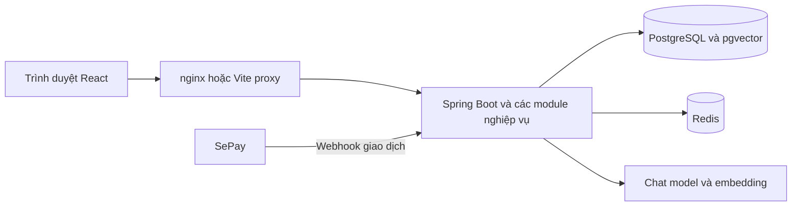

# Kịch bản thuyết trình và giải thích kỹ thuật HANBAY HOTEL

Tài liệu dùng để luyện nói và demo luồng khách hàng, từ đăng ký tài khoản đến AI hỗ trợ, tìm phòng, tạo booking, thanh toán SePay và bàn giao cho lễ tân. Mỗi chức năng có thao tác thành công, một tình huống lỗi, lời nói có thể đọc trực tiếp và phần giải thích cơ chế khi hội đồng hỏi sâu.

Phân vai theo phần cuối của kịch bản gốc: **Mạnh** mở đầu đăng ký và đăng nhập; **bạn** trình bày AI, tìm phòng, đặt phòng và thanh toán; **Mạnh** tiếp tục vận hành lễ tân và buồng phòng; **bạn** kết thúc bằng truy vấn AI về booking vừa xử lý. Nếu bạn phụ trách cả đăng ký và đăng nhập, có thể đọc nguyên phần đó mà không cần đổi nội dung.

Các giá trị mặc định và cơ chế bên dưới được đối chiếu với mã nguồn ngày **29 tháng 10 năm 2026**. Kết quả giá, số phòng và số tiền thực tế phải lấy từ môi trường demo.

**Cách luyện nói:** đọc các đoạn trích dẫn để tập lời trình bày; dùng phần thao tác để chạy demo; đọc phần cơ chế và câu hỏi ở cuối để chuẩn bị phản biện. Phần nói chính không cần đọc toàn bộ giải thích kỹ thuật.

**Đi nhanh tới nội dung:** [Chuẩn bị demo](#2-chuẩn-bị-dữ-liệu-và-môi-trường) · [Đăng ký](#4-đăng-ký-tài-khoản) · [Đăng nhập](#5-đăng-nhập-và-bảo-vệ-tài-khoản) · [RAG](#6-chat-rag-hỏi-chính-sách-khách-sạn) · [Function calling](#7-function-calling-tìm-phòng-và-tra-cứu-dữ-liệu) · [Giá động](#8-tìm-phòng-và-tính-giá-động) · [Booking](#9-tạo-booking-và-giữ-chỗ) · [SePay](#10-qr-sepay-và-cơ-chế-đối-soát-thanh-toán) · [Lễ tân và buồng phòng](#11-bàn-giao-lễ-tân-và-buồng-phòng) · [Bản 10 phút](#13-bản-nói-rút-gọn-khoảng-10-phút) · [Phản biện](#14-câu-hỏi-kỹ-thuật-thường-gặp-và-cách-trả-lời) · [Mã nguồn](#16-vị-trí-mã-nguồn-để-mở-khi-phản-biện).

## 1 Câu chuyện và thứ tự trình bày

### 1.1 Câu chuyện xuyên suốt

Một khách hàng cần lưu trú tại HANBAY HOTEL. Khách tạo tài khoản, hỏi trợ lý AI về chính sách, yêu cầu tìm phòng phù hợp, kiểm tra giá từng đêm, chọn dịch vụ bổ sung và tạo booking. Khách thanh toán bằng chuyển khoản theo QR. Backend nhận webhook từ SePay, đối soát và xác nhận booking. Lễ tân tiếp nhận booking, gán phòng khi check-in, xử lý check-out rồi chuyển phòng cho housekeeping. Cuối cùng, khách hỏi AI để kiểm tra lại trạng thái của chính booking này.

```text
Đăng ký → Đăng nhập → Hỏi chính sách bằng RAG
→ Tìm phòng và tính giá bằng function calling
→ Chọn phòng và add-on → Tạo booking PENDING
→ Tạo yêu cầu thanh toán và QR → SePay gửi webhook
→ Payment SUCCESS và booking CONFIRMED
→ Check-in và gán phòng → Check-out → Housekeeping
→ AI tra cứu lại booking và thanh toán
```

### 1.2 Phân bổ thời gian

| Chặng | Người trình bày | Nội dung | Thời gian gợi ý |
| --- | --- | --- | --- |
| 1 | Mạnh | Mở đầu, đăng ký và đăng nhập | 2 phút |
| 2 | Bạn | Policy RAG và trường hợp thiếu bằng chứng | 2 phút |
| 3 | Bạn | Function calling và bảo vệ dữ liệu cá nhân | 3 phút |
| 4 | Bạn | Tìm phòng, giá từng đêm, add-on và tạo booking | 3 phút |
| 5 | Bạn | QR, webhook, thanh toán thành công và một lỗi | 4 phút |
| 6 | Mạnh | Check-in, check-out và housekeeping | 4 phút |
| 7 | Bạn | AI kiểm tra lại trạng thái và kết thúc | 1 phút |

Tổng khoảng 19 phút. Chỉ chọn một hoặc hai tình huống lỗi để thao tác trực tiếp; các nhánh còn lại dùng để trả lời phản biện. Bản rút gọn 10 phút nằm ở mục 13.

## 2 Chuẩn bị dữ liệu và môi trường

### 2.1 Chuẩn bị trước buổi demo

- Một tài khoản khách có thể đăng nhập; chuẩn bị email và số điện thoại mới nếu demo đăng ký.
- Một tài khoản test riêng để thử sai mật khẩu và rate limit.
- Các tài khoản đúng vai trò `RECEPTIONIST`, `HOUSEKEEPER` và `MANAGER` cho phần vận hành.
- Ít nhất một hạng phòng đang hoạt động, có phòng vật lý phù hợp và còn tồn trong khoảng ngày demo.
- Một add-on đang hoạt động. Nếu muốn thể hiện giá động, chuẩn bị price rule áp dụng đúng ngày được chọn.
- Cấu hình AI chat, embedding và Policy RAG hoạt động; knowledge base đã được nạp.
- SePay hoặc công cụ gửi HTTP đã cấu hình webhook trỏ đến backend đang chạy.
- Mở sẵn DevTools Network để xem API, mã trạng thái HTTP và kết quả đối soát.

Nên dùng các phiên trình duyệt riêng cho khách và nhân viên. Như vậy, khi Mạnh đăng nhập tài khoản lễ tân, phiên khách vẫn còn để bạn hỏi AI ở cuối bài.

### 2.2 Chọn ngày để nối được phần lễ tân

Gọi **D** là ngày demo theo đồng hồ của backend. Với booking dùng để bàn giao check-in, đặt `checkInDate = D` và `checkOutDate = D + 3`. Ví dụ nếu demo ngày 29/10/2026, khoảng lưu trú là 29/10/2026 đến 01/11/2026, gồm ba đêm.

**Điểm phải thống nhất với Mạnh:** check-in hiện chỉ chấp nhận booking có ngày nhận phòng bằng ngày hiện tại. Checkout thường chỉ chạy khi đã đến hoặc qua ngày trả phòng dự kiến. Vì vậy, booking vừa check-in hôm nay cho ba đêm sẽ cần **trả phòng sớm** nếu muốn kết thúc ngay trong cùng buổi demo.

Có hai cách chuẩn bị:

| Phương án | Dữ liệu và cách thực hiện | Khi nên dùng |
| --- | --- | --- |
| Một booking xuyên suốt | Booking A nhận phòng ngày D, trả ngày D + 3. Thanh toán, check-in, sau đó dùng trả phòng sớm và tiếp tục housekeeping | Muốn kể trọn câu chuyện trên cùng một booking và có thể trình bày hoàn tiền |
| Hai booking cho vận hành | Booking A dùng thanh toán và check-in. Booking B được chuẩn bị trước ở trạng thái `CHECKED_IN`, có ngày trả phòng D và đã xử lý đủ công nợ để demo checkout thường | Muốn phần vận hành ngắn, không mở rộng sang hoàn tiền |

Nếu dùng hai booking, nói rõ khi chuyển sang booking B. Không thay đổi đồng hồ máy hoặc sửa trực tiếp database trong lúc thuyết trình để vượt điều kiện ngày.

### 2.3 Các thành phần trong Docker Compose

| Thành phần | Vai trò thực tế |
| --- | --- |
| Frontend | React được build và phục vụ qua nginx; cấu hình mặc định truy cập ở cổng 5173 |
| Backend | Spring Boot nhận API và xử lý nghiệp vụ; Compose hiện ánh xạ cổng backend 8081 |
| PostgreSQL và pgvector | Lưu dữ liệu nghiệp vụ, sự kiện webhook và vector chính sách |
| Redis | Lưu bộ đếm giới hạn yêu cầu và lịch sử hội thoại AI có thời hạn |
| MinIO | Lưu đối tượng như ảnh phục vụ các chức năng quản lý hình ảnh |
| pgAdmin | Công cụ xem và quản trị PostgreSQL khi cần kiểm tra dữ liệu demo |

Cổng host có thể được ghi đè bằng biến môi trường. Dùng cổng thực tế của máy demo khi cấu hình tunnel. Có thể kiểm tra bằng các lệnh đọc trạng thái sau:

```powershell
docker compose ps
docker compose logs --tail 80 backend
```

Webhook phải trỏ đúng đường dẫn `/api/v1/payments/sepay/webhook`. Với cấu hình cổng mặc định hiện tại, nếu tunnel kết nối trực tiếp backend thì đích nội bộ là `http://localhost:8081`. Khi domain tunnel đổi, cập nhật lại URL trên phía gửi webhook.

## 3 Mở đầu và giới thiệu kiến trúc

### 3.1 Lời mở đầu có thể đọc trực tiếp

> “Nhóm em sẽ trình bày hệ thống HANBAY HOTEL theo hành trình của một khách hàng. Khách bắt đầu từ tài khoản, được AI hỗ trợ tìm hiểu chính sách và tìm phòng, sau đó tạo booking và thanh toán chuyển khoản qua SePay. Booking được xác nhận sẽ chuyển sang quy trình lễ tân và buồng phòng. Trong quá trình demo, nhóm em sẽ chỉ ra cách backend kiểm tra dữ liệu, bảo vệ tài khoản và giữ trạng thái thanh toán nhất quán.”

### 3.2 Khi cần giới thiệu kỹ thuật trong khoảng 45 giây

> “Frontend của hệ thống sử dụng React và TypeScript. Backend sử dụng Java với Spring Boot, chia thành các module nghiệp vụ như xác thực, phòng, giá, booking, thanh toán và AI. PostgreSQL lưu dữ liệu chính; Redis hỗ trợ giới hạn yêu cầu và hội thoại. Phần AI tích hợp qua Spring AI, sử dụng công cụ nghiệp vụ để đọc dữ liệu thực và pgvector để tìm kiếm chính sách. Thanh toán được đối soát bằng webhook từ SePay.”

### 3.3 Cơ chế tổng thể

Backend hiện được triển khai như một ứng dụng Spring Boot có nhiều module nghiệp vụ. Các module dùng chung database và có thể tham gia cùng transaction. Không nên mô tả các module này thành các microservice độc lập.



Nếu trình xem Markdown không hỗ trợ Mermaid, có thể dùng sơ đồ chữ bên dưới để giải thích đường đi của một request thông thường.

```text
Trình duyệt React
    → nginx hoặc Vite proxy
    → Spring Security và bộ lọc
    → Controller nhận và kiểm tra request
    → Service áp dụng nghiệp vụ và transaction
    → Repository truy cập PostgreSQL
    → Response hoặc các sự kiện SSE trở về giao diện
```

| Công nghệ | Cơ chế cần giải thích khi được hỏi |
| --- | --- |
| TypeScript và Ant Design | Mô tả kiểu dữ liệu và xây dựng form, bảng, modal; kiểm tra giao diện giúp người dùng sửa dữ liệu sớm |
| TanStack Query | Quản lý dữ liệu gọi API, trạng thái tải, cập nhật và polling thanh toán |
| Spring Security và JWT | Xác thực danh tính, kiểm tra vai trò và cung cấp người dùng hiện tại cho service |
| JPA và transaction | Ánh xạ dữ liệu, ghi các thay đổi liên quan trong một giao dịch và sử dụng khóa khi cần |
| Flyway | Quản lý thay đổi cấu trúc database theo migration có phiên bản |
| Redis | Bộ đếm có TTL cho rate limit; lịch sử chat tách theo người dùng và hội thoại |
| Spring AI và pgvector | Điều phối chat model, tool calling, embedding và tìm kiếm chính sách theo ngữ nghĩa |
| SePay webhook | Đưa thông báo giao dịch vào backend để đối soát với payment |

**Câu chuyển:** “Em bắt đầu từ tài khoản khách hàng, vì đây là cơ sở để hệ thống liên kết lịch sử booking và giới hạn quyền truy cập dữ liệu cá nhân.”

## 4 Đăng ký tài khoản

### 4.1 Mục tiêu nghiệp vụ

Tạo tài khoản để khách đăng nhập, sử dụng AI và truy cập booking thuộc tài khoản của mình. Email và số điện thoại phải không bị trùng.

### 4.2 Thao tác thành công

1. Mở trang đăng ký.
2. Nhập họ tên, email mới, số điện thoại hợp lệ, mật khẩu và xác nhận mật khẩu trùng nhau.
3. Đồng ý điều khoản trên giao diện rồi nhấn đăng ký.
4. Chỉ ra thông báo tạo tài khoản thành công; chuyển sang màn hình đăng nhập bằng điều hướng trên giao diện.

Giao diện hiện hiển thị thông báo thành công và xóa dữ liệu form. Không trình bày rằng hệ thống luôn tự động đăng nhập hoặc tự chuyển trang sau đăng ký.

### 4.3 Lời nói khi thao tác

> “Ở bước này, khách tạo tài khoản bằng email và số điện thoại. Giao diện kiểm tra dữ liệu trước khi gửi; backend tiếp tục kiểm tra độc lập, đối chiếu thông tin trùng và băm mật khẩu trước khi lưu. Sau khi thành công, em chuyển sang đăng nhập bằng tài khoản vừa tạo.”

### 4.4 Cơ chế kỹ thuật

```text
Form đăng ký
→ POST /api/v1/auth/register
→ Bean Validation kiểm tra request
→ So khớp password và confirmPassword
→ Kiểm tra email và số điện thoại đã tồn tại
→ BCrypt băm mật khẩu
→ MapStruct ánh xạ request sang User
→ Lưu User trong transaction
→ Trả kết quả đăng ký
```

- Backend yêu cầu họ tên dài 2–150 ký tự, mật khẩu và xác nhận dài 8–72 ký tự. Email phải đúng định dạng. Số điện thoại backend nhận 9–15 chữ số.
- Frontend có kiểm tra số điện thoại Việt Nam và chuẩn hóa đầu `+84` sang `0` trước khi gửi. Không mô tả quy tắc frontend và backend là hoàn toàn giống nhau.
- Backend chuẩn hóa email, kiểm tra trùng và kiểm tra lại xung đột từ database. Ràng buộc duy nhất ở database xử lý được cả trường hợp hai request đăng ký cùng thông tin gần như đồng thời.
- BCrypt là băm một chiều có salt, dùng để so khớp khi đăng nhập; không có bước giải mã để lấy lại mật khẩu gốc.
- Checkbox đồng ý điều khoản đang thuộc form frontend; DTO đăng ký hiện không nhận trường này để lưu bằng chứng đồng ý.

### 4.5 Tình huống lỗi nên demo

Nhập email đã tồn tại và gửi lại. Kết quả mong đợi là request bị từ chối với lỗi xung đột, không tạo thêm tài khoản. Có thể dùng lỗi xác nhận mật khẩu không khớp nếu muốn thao tác nhanh hơn.

> “Kiểm tra ở frontend giúp người dùng nhập thuận tiện. Kiểm tra ở backend và database mới bảo đảm dữ liệu hợp lệ kể cả khi request được gửi trực tiếp mà không đi qua giao diện.”

**Câu chuyển:** “Sau khi có tài khoản, em đăng nhập để backend xác định khách hiện tại trước khi truy cập AI và dữ liệu booking cá nhân.”

## 5 Đăng nhập và bảo vệ tài khoản

### 5.1 Thao tác thành công và lời nói

Nhập đúng email hoặc số điện thoại cùng mật khẩu rồi đăng nhập. Mở khu vực booking của tôi hoặc trợ lý AI để cho thấy phiên xác thực đã hoạt động.

> “Backend xác thực thông tin đăng nhập rồi cấp access token và refresh token. Access token được gửi kèm các API cần xác thực. Khi truy vấn booking cá nhân, backend lấy danh tính từ token đã kiểm tra thay vì tin một user ID do trình duyệt tự khai báo.”

### 5.2 Cơ chế JWT và refresh token

```text
POST /api/v1/auth/login
→ Kiểm tra giới hạn IP và tài khoản trên IP
→ Tìm User và so khớp mật khẩu BCrypt
→ Kiểm tra tài khoản đang hoạt động
→ Cấp access token và refresh token
→ Frontend gắn Authorization Bearer khi gọi API riêng tư
→ JWT filter xác thực token và thiết lập SecurityContext
```

- Access token chứa thông tin cần thiết để xác thực request. Backend sử dụng Spring Security theo chế độ stateless cho HTTP session.
- Refresh token được lưu dưới dạng hash ở backend. Khi đổi token tại `POST /api/v1/auth/refresh-token`, backend khóa bản ghi, kiểm tra trạng thái và thời hạn, thu hồi token cũ rồi phát token mới. Đây là cơ chế rotation.
- Axios interceptor của frontend xử lý lỗi 401 bằng một yêu cầu refresh dùng chung cho các request đồng thời, rồi thử lại request gốc. Nếu refresh thất bại, phiên đăng nhập bị kết thúc.
- Frontend lưu token vào local storage hoặc session storage tùy lựa chọn ghi nhớ đăng nhập. Không mô tả cơ chế hiện tại thành refresh token nằm trong HttpOnly cookie.
- Thời hạn token phụ thuộc cấu hình. Trong Compose, giá trị dự phòng là access token 3.600 giây và refresh token 604.800 giây; môi trường thực có thể ghi đè.

### 5.3 Hai lớp giới hạn đăng nhập

| Lớp kiểm tra | Mặc định | Ý nghĩa |
| --- | --- | --- |
| Theo IP | 30 request trong 60 giây | Giới hạn lưu lượng đăng nhập, bao gồm request không hợp lệ |
| Theo tài khoản và IP | 5 lần sai trong 900 giây | Hạn chế dò mật khẩu mà không khóa toàn bộ tài khoản do một IP khác gây ra |

Redis thực hiện tăng bộ đếm và gán TTL bằng Lua script, giúp hai thao tác này được thực hiện nguyên tử. Đăng nhập thành công xóa bộ đếm sai của cặp tài khoản và IP đó. Bộ đếm IP vẫn áp dụng theo cửa sổ riêng.

Mỗi instance đồng thời duy trì cửa sổ cục bộ để tiếp tục hạn chế request khi Redis gián đoạn. Khi Redis mất kết nối, không nên khẳng định giới hạn toàn cụm vẫn được bảo đảm: phần dự phòng chỉ có hiệu lực trên từng instance. Bộ nhớ cục bộ giới hạn 10.000 key và có dọn key hết hạn.

Nginx ghi đè header chuyển tiếp IP từ phía client. Backend chỉ tin proxy đã cấu hình, nhằm tránh việc caller giả mạo `X-Forwarded-For` để thay đổi danh tính IP dùng cho rate limit.

### 5.4 Tình huống lỗi và lời giải thích

Trên tài khoản test riêng, nhập sai mật khẩu năm lần. Các lần sai trong ngưỡng trả lỗi thông tin đăng nhập. Request tiếp theo trong cửa sổ bị chặn với HTTP 429, mã `AUTH_RATE_LIMITED` và header `Retry-After` cho biết số giây còn phải chờ. Việc bị chặn diễn ra trước khi tiếp tục kiểm tra mật khẩu.

> “Giới hạn này được backend thực thi bằng bộ đếm có thời hạn. Phần đếm ngược trên giao diện giúp người dùng biết lúc thử lại; bảo vệ thực tế không phụ thuộc vào việc nút đăng nhập có bị vô hiệu hóa hay không.”

**Câu chuyển sang phần của bạn:** “Tài khoản đã xác thực. Tiếp theo, bạn em sẽ sử dụng trợ lý AI để hỏi chính sách và tìm phòng dựa trên dữ liệu của khách sạn.”

## 6 Chat RAG hỏi chính sách khách sạn

### 6.1 Mục tiêu và thao tác thành công

Mở cửa sổ chat AI sau khi đăng nhập. Hỏi:

> “Giờ check-in và check-out của khách sạn là mấy giờ?”

Hoặc:

> “Nếu trả phòng sớm thì khoản hoàn tiền được tính như thế nào?”

Chỉ ra nội dung trả lời và phần nguồn chính sách đi kèm. Đối với câu hỏi về số tiền của một booking cụ thể, cần dùng kết quả nghiệp vụ của backend; câu trả lời chính sách chung không thay thế phép tính cho booking đó.

### 6.2 Lời nói có thể đọc trực tiếp

> “Đây là cơ chế RAG, tức tìm nội dung liên quan trước rồi dùng nội dung đó làm căn cứ trả lời. Khi nhận câu hỏi về chính sách, trợ lý gọi công cụ tìm chính sách của khách sạn. Backend tìm các đoạn có ý nghĩa gần với câu hỏi trong pgvector, cung cấp cho mô hình và trả nguồn về giao diện. Cách này giúp câu trả lời dựa trên tài liệu do khách sạn quản lý.”

### 6.3 Giai đoạn chuẩn bị tri thức

```text
Tài liệu Markdown về chính sách
→ Đọc metadata và chia nội dung theo các mục chính sách
→ Tạo embedding cho từng đoạn
→ Lưu vector và metadata vào policy_vector_store
→ Lưu checksum của kho tài liệu để nhận biết thay đổi
```

- Loader ưu tiên tài liệu đóng gói trong `classpath:knowledge-base`; nếu không có, có đường dẫn dự phòng cho phát triển local tại `docs/knowledge-base`.
- Các đoạn tri thức được chia theo mục cấp ba của tài liệu. Metadata có mã tài liệu, tiêu đề, nhóm chính sách, nguồn, phiên bản, mục nội dung và chỉ số đoạn.
- Embedding biến văn bản thành vector số để so sánh mức gần nhau về ngữ nghĩa. Cấu hình dự phòng sử dụng `text-embedding-3-small`, 1.536 chiều.
- Vector nằm trong PostgreSQL có extension pgvector. Cấu hình dùng khoảng cách cosine và chỉ mục HNSW.
- Khi kho tri thức không đổi, checksum giúp bỏ qua việc nạp lại. Khi thay đổi, hệ thống nạp các đoạn hiện tại và loại đoạn cũ không còn tồn tại.

Đây là nạp và truy xuất tri thức, không phải huấn luyện lại hay fine-tune mô hình.

### 6.4 Giai đoạn trả lời câu hỏi

```text
Tin nhắn → Unified assistant
→ Model yêu cầu gọi search_hotel_policy
→ Vector hóa câu hỏi và tìm các đoạn gần nghĩa
→ Lọc theo top K và ngưỡng tương đồng
→ Cung cấp nội dung và metadata nguồn cho model
→ Backend xử lý câu trả lời và phát sự kiện SSE
→ Giao diện hiển thị câu trả lời cùng nguồn
```

Mặc định cấu hình lấy tối đa ba đoạn với `similarity-threshold = 0.18`. Các giá trị này có thể ghi đè bằng biến môi trường; ngưỡng tương đồng không phải tỷ lệ bảo đảm câu trả lời đúng 18% hay 82%.

### 6.5 Trường hợp không có bằng chứng

Thử hỏi một nội dung ngoài phạm vi chính sách, chẳng hạn:

> “Khách sạn có cho tôi vay 500 triệu không?”

Nếu công cụ tìm kiếm không có bằng chứng hoặc Policy RAG không được bật, công cụ trả `NO_POLICY_EVIDENCE`. Với trường hợp đã tìm nhưng không có nguồn, backend thay câu trả lời bằng thông báo:

> “Xin lỗi, tôi chưa tìm thấy thông tin này trong chính sách khách sạn.”

Không nên cam kết mọi câu hỏi ngoài phạm vi đều bị chặn tuyệt đối: kết quả còn phụ thuộc việc model chọn công cụ và chất lượng truy xuất. Có thể chuẩn bị trước một câu hỏi đã kiểm tra cho demo no-evidence.

> “Hệ thống có xử lý rõ trường hợp không tìm được bằng chứng để hạn chế câu trả lời suy đoán. Nguồn hiển thị cho phép người dùng và nhóm phát triển đối chiếu lại tài liệu.”

### 6.6 Một cửa sổ chat và cơ chế SSE

Policy RAG và function calling dùng chung endpoint `POST /api/v1/ai/chat/stream`; không phải hai chatbot độc lập. Các sự kiện có thể gồm `delta`, `action`, `sources`, `done` hoặc `error`.

**Chi tiết để trả lời câu hỏi kỹ thuật:** code hiện gọi stream từ provider nhưng gom các chunk bằng `collectList()`, sau đó phân tích toàn bộ kết quả và mới phát phần trả lời. Vì vậy, có SSE không đồng nghĩa giao diện hiện nhận từng token ngay khi provider sinh ra. Cách phát hiện tại cho phép backend xử lý action và thay câu trả lời khi thiếu bằng chứng trước khi gửi nội dung cuối.

Nếu AI lỗi, kiểm tra cấu hình provider, kết nối và trạng thái index. Cấu hình nền mặc định tắt RAG; Compose hiện có giá trị dự phòng bật RAG và dùng embedding OpenAI. Không kết luận RAG hoạt động chỉ vì cửa sổ chat mở được.

**Câu chuyển:** “Vừa rồi AI lấy căn cứ từ tài liệu chính sách. Với số phòng và giá lưu trú, em chuyển sang các function nghiệp vụ để lấy dữ liệu đang có trong hệ thống.”

## 7 Function calling tìm phòng và tra cứu dữ liệu

### 7.1 Thao tác thành công

Nhập một câu có đủ ngày và số khách. Thay D bằng ngày demo thực tế:

> “Tôi cần phòng cho 2 người lớn từ D đến D cộng 3 ngày. Hãy tìm hạng phòng còn trống và cho biết tổng giá ba đêm.”

Khi đã có kết quả, hỏi tiếp bằng tên hạng phòng thực tế:

> “Cho tôi xem tiện nghi của hạng phòng này và tính giá từng đêm.”

Để tránh sai lệch ngày, lúc luyện nên nhập ngày đầy đủ dạng ngày/tháng/năm. Hệ thống có bổ sung ngữ cảnh thời gian và chuẩn hóa cách hiểu ngày thiếu năm, nhưng demo với ngày cụ thể sẽ dễ đối chiếu hơn.

### 7.2 Lời nói khi demo

> “Model nhận diện nhu cầu và đề xuất lời gọi công cụ với tham số như ngày lưu trú, số khách và hạng phòng. Spring AI thực thi công cụ đã được backend cho phép. Công cụ gọi lại service nghiệp vụ để kiểm tra phòng trống và tính giá. Kết quả thực được đưa về model để diễn đạt thành câu trả lời dễ hiểu.”

### 7.3 Cơ chế xử lý

```text
Người dùng hỏi bằng ngôn ngữ tự nhiên
→ Model chọn tool trong danh sách được khai báo
→ Backend chuyển tham số về kiểu Java như LocalDate và UUID
→ Service nghiệp vụ kiểm tra dữ liệu và quyền
→ Tool trả kết quả có cấu trúc
→ Model diễn đạt kết quả cho người dùng
```

Model không được tự viết SQL để truy vấn database. Dữ liệu được lấy qua các phương thức Java được khai báo `@Tool`, với phạm vi do ứng dụng kiểm soát.

### 7.4 Danh sách công cụ đang có

| Công cụ | Dữ liệu hoặc chức năng |
| --- | --- |
| `search_hotel_policy` | Tìm đoạn chính sách làm bằng chứng |
| `search_available_rooms` | Tìm hạng phòng còn trống theo ngày, số người lớn và trẻ em |
| `calculate_stay_price` | Tính giá từng đêm và tổng tiền phòng cho hạng phòng đã chọn |
| `get_room_type_details` | Lấy mô tả, tiện nghi, ảnh và sức chứa bằng tên hạng phòng |
| `list_active_addons` | Liệt kê dịch vụ bổ sung đang hoạt động |
| `get_my_bookings` | Xem booking của người dùng hiện tại |
| `get_booking_details` | Xem một booking thuộc người dùng hiện tại qua mã booking |
| `get_payment_status` | Xem trạng thái payment qua UUID payment lấy từ booking hợp lệ |
| `check_cancellation_eligibility` | Kiểm tra điều kiện và mức hoàn dự kiến; không thực hiện hủy |

Các công cụ nghiệp vụ hiện phục vụ đọc và tư vấn. AI không tự tạo booking, hủy booking, chuyển tiền hoặc xác nhận hoàn tiền. Nếu giao diện hiển thị action gợi ý, người dùng vẫn đi tới màn hình nghiệp vụ để thao tác.

### 7.5 Bảo vệ dữ liệu cá nhân

- Endpoint chat yêu cầu đăng nhập. Khách chưa đăng nhập được yêu cầu xác thực trước khi dùng assistant.
- Công cụ booking và payment sử dụng người dùng hiện tại từ SecurityContext. Chữ ký tool không nhận một `userId` tùy ý từ model.
- Service truy vấn booking kèm chủ sở hữu hoặc kiểm tra quyền trước khi trả payment. Có mã booking của người khác không làm phát sinh quyền xem.
- Luồng reactive mang theo ngữ cảnh request bằng context snapshot để công cụ nghiệp vụ có thể dùng ngữ cảnh xác thực khi xử lý bất đồng bộ.
- Lịch sử chat trên Redis tách theo `userId` và `conversationId`, có TTL một giờ và giữ tối đa 12 message. Khi Redis lỗi có bộ nhớ cục bộ dự phòng; không coi bộ nhớ đó là lưu trữ hội thoại bền vững toàn cụm.
- Chat có giới hạn mặc định 10 yêu cầu mỗi phút theo danh tính đã xác thực. Logging AI che nội dung prompt và không lưu nguyên văn response vào bản ghi theo dõi.

### 7.6 Tình huống lỗi nên trình bày

**Không có hạng phòng phù hợp:** yêu cầu số khách vượt khả năng của tất cả hạng phòng hoặc chọn khoảng ngày hết chỗ. Với yêu cầu 20 người, công cụ hiện tìm hạng phòng cho một yêu cầu; không nên mô tả nó là thuật toán tự chia 20 người thành nhiều phòng.

> “Kết quả trả về rỗng nghĩa là không có lựa chọn phù hợp với điều kiện đã gửi. AI có thể đề nghị đổi ngày hoặc số khách, nhưng không được khẳng định có phòng khi backend không trả dữ liệu đó.”

**Tra cứu booking người khác:** dùng tài khoản khách khác và một mã booking đã chuẩn bị. Backend không trả thông tin booking không thuộc người đang đăng nhập.

> “Prompt chỉ hướng dẫn model. Quyền truy cập thực tế được backend thực thi, nên việc người dùng yêu cầu AI bỏ qua quy tắc không thay đổi được chủ sở hữu của booking.”

**Câu chuyển:** “Em sẽ sử dụng các ngày và hạng phòng vừa tìm được để đi qua màn hình đặt phòng, qua đó đối chiếu giá AI cung cấp với kết quả tính chính thức.”

## 8 Tìm phòng và tính giá động

### 8.1 Thao tác thành công

1. Chọn ngày nhận, ngày trả và số người.
2. Tìm hạng phòng còn trống.
3. Chọn một hạng phòng, xem tiện nghi và bảng giá từng đêm.
4. Chọn add-on nếu cần, kiểm tra số lượng và tổng tiền.

> “Khách đặt theo hạng phòng. Phòng vật lý cụ thể như số 301 sẽ được lễ tân gán khi check-in. Giá của kỳ lưu trú được tính từ từng đêm trong khoảng ngày đã chọn và các dịch vụ bổ sung.”

### 8.2 Cách kiểm tra phòng trống

Hệ thống đếm năng lực bán của hạng phòng và trừ các booking giao nhau với khoảng lưu trú. Booking `CONFIRMED`, `CHECKED_IN` và booking `PENDING` còn hạn đều chiếm chỗ.

```text
Số chỗ còn có thể đặt
    = Số phòng thuộc nhóm trạng thái được tính vào năng lực bán
      − Số booking đang chiếm chỗ trong khoảng ngày yêu cầu
```

Điều kiện hai kỳ lưu trú giao nhau có dạng:

```text
booking.checkInDate < ngày trả được yêu cầu
và booking.checkOutDate > ngày nhận được yêu cầu
```

Khoảng lưu trú được hiểu theo `[check-in, check-out)`, nên booking trả ngày D không chiếm đêm D. Cùng ngày có khách trả và khách nhận không tự tạo xung đột về đêm lưu trú; việc nhận phòng thực tế còn phụ thuộc phòng đã dọn xong.

Trong bộ tính tồn hiện tại, các trạng thái `AVAILABLE`, `OCCUPIED`, `DIRTY`, `CLEANING` được tính vào năng lực bán theo hạng phòng; booking và ngày lưu trú quyết định phần đang bị giữ. Điều này khác với gán phòng lúc check-in: lúc đó phòng vật lý phải là `AVAILABLE`. Không được kết luận phòng `DIRTY` có thể giao ngay cho khách.

### 8.3 Cách tính giá từng đêm

Backend lấy giá cơ bản của hạng phòng và các price rule đang hoạt động, có hiệu lực trong khoảng lưu trú. Với mỗi đêm:

1. Xác định các quy tắc áp dụng cho ngày đó.
2. Chọn một quy tắc điều chỉnh theo giai đoạn, ưu tiên nhóm ngày lễ, cuối tuần rồi mùa vụ.
3. Tính giá sau điều chỉnh bằng số tiền cố định hoặc tỷ lệ phần trăm.
4. Chọn một khuyến mãi công khai cho mức giảm tốt nhất để áp dụng tiếp.
5. Chặn giá âm, lưu giá đêm và cộng vào tổng.

```text
Giá đêm = Giá cơ bản + Phụ thu − Giảm theo giai đoạn − Khuyến mãi
Tiền phòng = Tổng giá các đêm từ check-in đến trước check-out
Tổng booking = Tiền phòng + Tiền dịch vụ bổ sung
```

Ví dụ minh họa: giá gốc 1.000.000 đồng, phụ thu cuối tuần 20% tạo mức 1.200.000 đồng; khuyến mãi 10% áp dụng sau đó giảm 120.000 đồng, còn 1.080.000 đồng. Ví dụ này chỉ đúng nếu có các rule tương ứng trong dữ liệu.

Một kỳ lưu trú có thể cho ba đêm lần lượt 1.200.000, 1.350.000 và 1.500.000 đồng, tổng 4.050.000 đồng. Khi demo, đọc các giá đang xuất hiện trên hệ thống thay vì mặc định dữ liệu luôn khớp ví dụ.

### 8.4 Snapshot bảo vệ giá booking

Khi tạo booking, backend tự tính lại giá và ghi `BookingNight` cho từng đêm. Các rule đã áp dụng có bản ghi liên kết với giá trị điều chỉnh. Với add-on, backend lưu số lượng và đơn giá tại thời điểm tạo booking.

Snapshot có nghĩa là lưu kết quả giá của giao dịch tại thời điểm đó. Việc quản lý sửa giá cơ bản hoặc giá add-on sau này không tự động định giá lại booking đã lưu. Nếu khách sửa booking đang `PENDING`, hệ thống có luồng chủ động kiểm tra và tính lại.

> “Frontend không quyết định số tiền phải thanh toán bằng cách gửi một tổng tiền tùy ý. Backend tính từ hạng phòng, ngày và add-on hợp lệ rồi lưu kết quả để sử dụng nhất quán cho booking và payment.”

### 8.5 Tình huống lỗi

Chọn ngày trả trước ngày nhận, chọn ngày nhận trong quá khứ hoặc số khách vượt sức chứa. Backend từ chối dữ liệu không hợp lệ. Việc frontend đã khóa một lựa chọn không thay thế kiểm tra backend.

Nếu được hỏi về hai người cùng đặt phòng cuối cùng:

> “Kết quả tìm phòng chỉ đúng tại thời điểm truy vấn. Khi tạo booking, backend mở transaction, khóa bản ghi hạng phòng bằng pessimistic write rồi kiểm tra tồn lại trước khi lưu. Request đến sau phải kiểm tra trên dữ liệu đã được cập nhật, giúp tránh bán cùng chỗ cho hai booking.”

Khóa này nằm ở PostgreSQL thông qua JPA; không phải distributed lock Redis. Hiệu quả phụ thuộc các luồng làm thay đổi tồn cùng tuân thủ giao thức khóa và transaction.

**Câu chuyển:** “Sau khi kiểm tra giá và thông tin khách, em tạo booking để hệ thống chính thức giữ chỗ trong thời gian chờ thanh toán.”

## 9 Tạo booking và giữ chỗ

### 9.1 Thao tác thành công và lời nói

Chọn hạng phòng, nhập thông tin khách chính, chọn add-on, kiểm tra ngày và xác nhận đặt phòng. Chỉ ra mã booking, tổng tiền, trạng thái `PENDING` và hạn giữ chỗ.

> “Booking được tạo ở trạng thái chờ thanh toán và giữ chỗ trong 15 phút. Đây là thời gian để khách hoàn tất chuyển khoản. Booking và yêu cầu thanh toán là hai đối tượng riêng; bước tiếp theo hệ thống mới tạo payment và QR tương ứng.”

### 9.2 Cơ chế tạo booking

```text
POST /api/v1/bookings
→ Xác định tài khoản hiện tại nếu có
→ Kiểm tra ngày lưu trú
→ Khóa hạng phòng và kiểm tra trạng thái cùng sức chứa
→ Kiểm tra lại availability
→ Tạo booking PENDING với expiredAt bằng hiện tại cộng 15 phút
→ Lưu khách chính, add-on và giá từng đêm
→ Lưu booking trong transaction
→ Trả bookingId, bookingCode, tổng tiền, expiredAt và booking access token
```

Backend có retry khi sinh mã booking gặp xung đột duy nhất. Retry này xử lý trùng mã booking; không có nghĩa mọi request đặt phòng bị gửi hai lần đều tự hợp nhất thành một booking.

### 9.3 Quyền của khách có tài khoản và khách vãng lai

Luồng demo nên đăng nhập để booking gắn với tài khoản và truy vấn lại được bằng AI. Tuy nhiên, API tạo booking còn hỗ trợ khách vãng lai.

Booking có access token riêng; backend lưu hash của token và trả token gốc cho checkout flow. Với các API cập nhật booking đang chờ và thanh toán, service kiểm tra chủ sở hữu hoặc token tương ứng qua header `X-Booking-Access-Token`.

Vì vậy, một endpoint được cấu hình `permitAll` không có nghĩa ai có mã booking cũng đọc hoặc sửa được. Một số kiểm tra quyền nằm trong service để hỗ trợ cả tài khoản đã đăng nhập và khách vãng lai có token hợp lệ. AI chỉ dùng quyền người dùng hiện tại và không nhận booking token tùy ý từ model.

### 9.4 Khi booking hết hạn

Scheduler mặc định chạy mỗi phút để chuyển booking `PENDING` quá hạn sang `EXPIRED`. Việc đổi nhãn trong database có thể chờ tới lần quét tiếp theo.

Kiểm tra tồn chỉ tính booking `PENDING` còn hạn, nên việc giải phóng khả năng đặt không phải chờ đúng lúc scheduler đổi nhãn. Khi cập nhật booking hoặc xác nhận thanh toán, service cũng kiểm tra hạn sử dụng bằng đồng hồ backend.

> “Đồng hồ đếm ngược trên giao diện giúp khách theo dõi thời gian. Điều kiện quyết định nằm ở `expiredAt` trên backend, nên đóng tab hoặc thay đổi đồng hồ trình duyệt không kéo dài được thời gian giữ chỗ.”

### 9.5 Tình huống lỗi

Dùng một booking đã chuẩn bị sẵn để hết hạn rồi thử sửa hoặc tạo yêu cầu thanh toán. Backend từ chối vì booking không còn hợp lệ. Không nên chờ 15 phút trong lúc demo trực tiếp.

Khi sửa booking `PENDING`, backend tính giá lại. Các payment đang chờ có số tiền cũ không còn khớp sẽ bị hủy để tránh tiếp tục thanh toán theo tổng tiền đã lỗi thời.

**Câu chuyển:** “Booking đã giữ chỗ thành công. Em tạo yêu cầu thanh toán để khách nhận đúng tài khoản, số tiền và mã nội dung chuyển khoản.”

## 10 QR SePay và cơ chế đối soát thanh toán

### 10.1 Tạo yêu cầu thanh toán

Thao tác trên màn hình thanh toán để tạo hoặc hiển thị QR. Chỉ rõ ngân hàng nhận, số tài khoản, tên tài khoản, số tiền, nội dung chuyển khoản và thời hạn.

> “QR chứa thông tin để khách chuyển khoản đúng người nhận và đúng mã thanh toán. Việc tạo QR chưa chứng minh khách đã trả tiền. Trạng thái thành công chỉ được xác định sau khi backend đối soát giao dịch nhận được.”

```text
POST /api/v1/payments/requests
→ Khóa booking và kiểm tra quyền checkout
→ Kiểm tra booking còn có thể thanh toán
→ Tính số còn phải trả từ dữ liệu backend
→ Tái sử dụng payment PENDING còn hiệu lực và cùng số tiền nếu có
→ Hoặc tạo payment mới với paymentCode riêng
→ Sinh URL ảnh QR từ thông tin SePay đã cấu hình
```

Ở booking mới, số phải trả thường bằng toàn bộ tổng booking. Luồng hiện cũng hỗ trợ thanh toán phần còn thiếu cho booking phù hợp sau điều chỉnh; không nên khẳng định hệ thống chỉ có một payment duy nhất cho mọi booking.

Payment có thời hạn riêng. Khi booking đang chờ, thời hạn payment không được vượt quá hạn giữ chỗ của booking. Tạo lại QR không làm khởi động lại 15 phút giữ chỗ.

### 10.2 Phân biệt các loại mã

| Loại mã | Ý nghĩa và nơi sử dụng |
| --- | --- |
| Mã booking | Nhận diện đặt phòng để khách và lễ tân tra cứu |
| Payment ID | UUID nội bộ để gọi API trạng thái payment |
| Payment code | Nội dung chuyển khoản có dạng `PAY-...`; dùng đối soát tiền vào |
| SePay event ID | ID giao dịch do phía gửi cấp; dùng chống xử lý webhook trùng |
| Mã tham chiếu ngân hàng | Mã của giao dịch ngân hàng, phục vụ đối chiếu; khi hoàn thủ công, manager nhập mã của lần chuyển hoàn |

### 10.3 Thao tác thanh toán thành công

1. Mở payment của booking mới và sao chép đúng nội dung chuyển khoản.
2. Trên công cụ mô phỏng hoặc môi trường SePay test đã chuẩn bị, tạo giao dịch **tiền vào** với tài khoản nhận, nội dung và số tiền khớp payment.
3. Gửi về URL `https://<domain-dang-dung>/api/v1/payments/sepay/webhook`.
4. Kiểm tra response và màn hình booking hoặc payment monitoring.
5. Chỉ ra payment `SUCCESS` và booking `CONFIRMED`.

> “SePay gửi thông báo giao dịch về backend. Backend xác thực API key, kiểm tra trùng, kiểm tra tiền vào và tài khoản nhận, sau đó tìm payment từ mã chuyển khoản. Nếu booking còn hiệu lực và tổng tiền đã nhận đủ, backend ghi nhận thanh toán thành công và xác nhận booking trong cùng transaction.”

### 10.4 Các bước backend thực hiện

```text
SePay gửi POST webhook
→ Controller kiểm tra cấu trúc payload
→ Service kiểm tra Authorization Apikey
→ Khóa chống trùng theo event ID
→ Bỏ qua event đã xử lý
→ Lưu sự kiện và payload
→ Kiểm tra loại giao dịch và tài khoản nhận
→ Trích paymentCode từ code, content hoặc description
→ Khóa booking rồi payment liên quan
→ Ghi PaymentTransaction thành công
→ Cộng tổng tiền vào hợp lệ của payment
→ Xét booking còn hiệu lực, đủ tiền, thiếu tiền hoặc cần hoàn
→ Cập nhật event PROCESSED hoặc IGNORED
→ Commit transaction rồi trả HTTP 200
```

Header xác thực dùng dạng `Authorization: Apikey <key-da-cau-hinh>`. Luồng webhook dùng khóa của nhà cung cấp, không dùng access token đăng nhập của khách. So sánh key dùng `MessageDigest.isEqual`.

Code hiện xử lý đối soát ngay trong transaction của request webhook. Không trình bày luồng hiện tại thành “trả 200 trước rồi đưa vào message queue xử lý sau”. Database có các trường và phương thức liên quan trạng thái xử lý nhưng chúng không làm đường gọi này trở thành một hàng đợi bất đồng bộ.

### 10.5 Payload mẫu để hiểu khi demo

Các giá trị đặt trong dấu `<...>` cần thay bằng dữ liệu thật từ payment và cấu hình demo. Số tiền và ID dưới đây chỉ minh họa; đổi ID khi tạo một giao dịch mới, giữ nguyên ID khi kiểm tra webhook trùng.

```http
POST /api/v1/payments/sepay/webhook
Authorization: Apikey <key-da-cau-hinh>
Content-Type: application/json
```

```json
{
  "id": 900001,
  "gateway": "<ngan-hang-da-cau-hinh>",
  "transactionDate": "2026-10-29 10:00:00",
  "accountNumber": "<tai-khoan-nhan-da-cau-hinh>",
  "code": "<paymentCode-sao-chep-tu-he-thong>",
  "content": "<paymentCode-sao-chep-tu-he-thong>",
  "transferType": "in",
  "transferAmount": 4050000,
  "accumulated": 0,
  "description": "Giao dich mo phong thanh toan booking",
  "referenceCode": "DEMO-900001"
}
```

Ngày giao dịch phải dùng định dạng `yyyy-MM-dd HH:mm:ss`; backend quy đổi theo `Asia/Ho_Chi_Minh`. Việc booking còn hạn được kiểm tra bằng thời điểm backend xử lý, không chỉ bằng ngày giao dịch mà caller gửi vào payload.

### 10.6 Trạng thái cần chỉ trên màn hình

| Tình huống | Payment | Booking | Event và xử lý liên quan |
| --- | --- | --- | --- |
| Tạo booking, chưa tạo payment | Chưa có yêu cầu payment | `PENDING` | Chưa có webhook |
| Tạo QR thành công | `PENDING` | `PENDING` | Chờ giao dịch |
| Nhận một phần tiền hợp lệ khi còn hạn | Vẫn `PENDING` | Vẫn `PENDING` | Ghi transaction và cộng dồn; event `PROCESSED` |
| Tổng tiền hợp lệ đủ khi booking còn hạn | `SUCCESS` | `CONFIRMED` | Event `PROCESSED` |
| Nhận dư khi hoàn tất thanh toán hợp lệ | `SUCCESS` | `CONFIRMED` | Tạo refund `PENDING` cho phần chênh lệch |
| Tiền đến khi booking đã mất hiệu lực | Được đối soát tiền nhận theo nhánh late payment | Không xác nhận lại booking | Tạo refund `PENDING` cho khoản tiền đến trễ |
| Sai tài khoản nhận, tiền ra hoặc không tìm được payment | Không xác nhận từ event đó | Không xác nhận từ event đó | Event `IGNORED` kèm lý do |
| Gửi lại cùng event ID | Không cộng thêm tiền | Không đổi thêm do bản gửi trùng | Bỏ qua trước khi tạo giao dịch mới |

`RECEIVED` là trạng thái khởi tạo event. Sau đường xử lý thành công hiện tại, trạng thái được quan sát thường là `PROCESSED`; các event không áp dụng là `IGNORED`. Không dùng `RECEIVED` làm trạng thái kết thúc cho mọi webhook.

### 10.7 Tình huống lỗi và câu giải thích

**Sai API key:** với payload hợp lệ và key sai, backend trả 401; không đối soát tiền từ request đó.

> “Webhook cũng là một đầu vào cần xác thực. API key chứng minh request biết khóa tích hợp được cấu hình; backend không tin một payload chỉ vì nó có hình dạng giống giao dịch ngân hàng.”

**Sai URL hoặc tunnel cũ:** tùy điểm lỗi có thể nhận 404, lỗi kết nối hoặc phản hồi từ tunnel. Không khẳng định mọi trường hợp domain cũ đều trả 404.

> “Em cần phân biệt lỗi đường truyền và định tuyến với lỗi nghiệp vụ. URL phải tới đúng backend và đúng endpoint thì bước kiểm tra API key, mã thanh toán mới có thể chạy.”

**Chuyển thiếu tiền:** hệ thống ghi nhận giao dịch hợp lệ và cộng dồn. Ví dụ cần 4.050.000 đồng, lần đầu 2.000.000 đồng thì chưa xác nhận booking; một giao dịch khác 2.050.000 đồng khi còn hạn có thể hoàn tất thanh toán.

> “Thiếu tiền không đồng nghĩa vứt bỏ giao dịch. Hệ thống ghi nhận đúng số tiền đã nhận và chờ đủ tổng yêu cầu; booking chỉ được xác nhận khi các điều kiện nghiệp vụ cùng thỏa mãn.”

**Sai mã hoặc sai tài khoản nhận:** event hợp lệ về xác thực có thể vẫn trả HTTP 200 nhưng được đánh dấu `IGNORED`. HTTP 200 xác nhận xử lý request an toàn, không phải bằng chứng booking đã thanh toán.

**Webhook bị gửi lại:** gửi lại đúng payload với cùng ID.

> “Backend khóa theo khóa chống trùng của event, rồi kiểm tra event và provider transaction ID đã tồn tại. Vì vậy, hai bản gửi cùng giao dịch không làm tăng số tiền nhận hai lần.”

Cơ chế dùng PostgreSQL advisory transaction lock cho khóa `sepay:event:<id>`, kiểm tra tồn tại và các ràng buộc dữ liệu liên quan. Khóa theo event xử lý cả trường hợp hai bản sao tới gần như đồng thời; khóa booking và payment bảo vệ cập nhật số tiền và trạng thái.

### 10.8 Frontend biết thanh toán đã xong như thế nào

Frontend dùng polling API `GET /api/v1/payments/{paymentId}/status` thông qua TanStack Query, với quy tắc dừng hoặc điều chỉnh theo trạng thái và lỗi. Khi trạng thái thay đổi, giao diện hiển thị hoặc điều hướng sang kết quả.

SePay gọi backend; trình duyệt đọc trạng thái từ backend. Luồng này không phải SePay gọi trực tiếp vào giao diện, cũng không phải WebSocket thông báo thanh toán.

**Câu chuyển bàn giao:** “Payment đã thành công và booking đã được xác nhận. Em bàn giao mã booking này cho Mạnh để tiếp tục quy trình nhận phòng, gán phòng vật lý và xử lý phòng sau khi khách rời đi.”

## 11 Bàn giao lễ tân và buồng phòng

### 11.1 Check-in và gán phòng

Mạnh đăng nhập bằng tài khoản `RECEPTIONIST`, tìm booking vừa xác nhận, mở danh sách phòng vật lý phù hợp và chọn một phòng `AVAILABLE` cùng hạng phòng.

> “Khi đặt phòng, khách chọn hạng phòng. Tại thời điểm nhận phòng, lễ tân mới gán phòng vật lý đang sẵn sàng. Backend kiểm tra booking đã xác nhận, đúng ngày nhận và phòng cùng hạng đang trống trước khi đổi trạng thái.”

```text
Booking CONFIRMED + checkInDate bằng ngày hiện tại
    + Phòng cùng hạng và AVAILABLE
→ Khóa booking và phòng
→ Gán phòng, ghi người thực hiện
→ Booking CHECKED_IN và phòng OCCUPIED
```

Tình huống lỗi có thể chọn: check-in lần hai, chọn phòng khác hạng, phòng đã bận hoặc booking chưa đến ngày nhận. Backend trả xung đột thay vì gán phòng tiếp.

### 11.2 Checkout thường

Dùng booking B đã chuẩn bị tới ngày trả phòng nếu muốn demo checkout thường. Lễ tân kiểm tra công nợ, phí phát sinh và số tiền thu thêm rồi xác nhận.

> “Checkout chỉ hoàn tất khi booking đang lưu trú và số còn phải thu đã được xử lý đúng. Phòng sau khi khách rời đi chuyển sang trạng thái bẩn để bộ phận buồng phòng tiếp nhận.”

```text
Booking CHECKED_IN và đã đến ngày trả phòng
→ Kiểm tra phòng đang OCCUPIED
→ Kiểm tra phí phát sinh, lý do và số tiền thu thêm
→ Xử lý khoản cần thu tại quầy
→ Booking CHECKED_OUT và phòng DIRTY
```

Nếu checkout trước ngày dự kiến, backend yêu cầu dùng early checkout. Nếu thu chưa đủ khoản còn phải trả, không hoàn tất checkout. Phí phát sinh phải có lý do theo yêu cầu của luồng.

### 11.3 Trả phòng sớm để giữ một booking xuyên suốt

Với booking A mới check-in trong buổi demo, mở tính toán trả phòng sớm, kiểm tra ngày trả thực tế, khoản chưa sử dụng, tiền phạt, khoản bù trừ và thông tin ngân hàng nhận hoàn nếu có.

> “Đây là trả phòng sớm nên hệ thống sử dụng giá từng đêm đã lưu trong booking. Phần đêm chưa sử dụng được tính phạt 20%, phần còn lại dùng để hoàn sau khi trừ công nợ và phí phát sinh. Khi xác nhận, booking kết thúc và phòng chuyển DIRTY; tiền hoàn được tạo thành yêu cầu để manager xử lý.”

```text
Giá trị chưa sử dụng = Tổng giá snapshot các đêm từ ngày trả sớm trở đi
Tiền phạt = 20% × Giá trị chưa sử dụng
Khoản hoàn theo chính sách = Giá trị chưa sử dụng − Tiền phạt
Khoản cần bù trừ = Công nợ trước trả sớm + Phí phát sinh
Thực hoàn = max(Khoản hoàn theo chính sách − Khoản cần bù trừ, 0)
Cần thu thêm = max(Khoản cần bù trừ − Khoản hoàn theo chính sách, 0)
```

Ví dụ minh họa: giá trị chưa sử dụng 2.000.000 đồng, tiền phạt 400.000 đồng, khoản hoàn theo chính sách 1.600.000 đồng. Nếu còn nợ và phí tổng cộng 300.000 đồng, thực hoàn là 1.300.000 đồng. Số tiền của booking demo phải lấy từ kết quả backend.

Luồng kiểm tra booking `CHECKED_IN` và ngày trả sớm nằm từ ngày nhận đến trước ngày trả dự kiến. Backend khóa booking và phòng, tạo refund nếu cần rồi cập nhật checkout trong transaction. Request thu thêm phải khớp khoản cần thu sau bù trừ; không nhập tiền thu tùy ý vượt mức.

### 11.4 Housekeeping

Mạnh chuyển sang tài khoản `HOUSEKEEPER`, mở danh sách phòng cần xử lý, chọn phòng vừa checkout, bắt đầu dọn rồi hoàn tất.

> “Phòng đã trả chưa sẵn sàng giao cho khách tiếp theo. Nhân viên buồng phòng bắt đầu dọn để chuyển sang CLEANING; sau khi hoàn tất, phòng trở lại AVAILABLE và lễ tân mới có thể gán để check-in.”

```text
DIRTY → CLEANING → AVAILABLE
```

Service khóa phòng và dùng phương thức domain để kiểm tra trạng thái chuyển tiếp. Bấm hoàn tất dọn ở trạng thái không phù hợp hoặc gọi API bằng tài khoản không có quyền bị từ chối.

### 11.5 Quay lại AI kiểm tra trạng thái

Bạn trở về phiên đăng nhập của khách đã tạo booking và hỏi:

> “Hãy cho tôi biết trạng thái booking <mã booking vừa demo> và tình trạng thanh toán hiện tại.”

Assistant có thể tra booking, lấy payment ID rồi gọi công cụ trạng thái thanh toán. Đối chiếu với phần lễ tân vừa thao tác.

> “Ở bước cuối, AI sử dụng lại công cụ đọc dữ liệu hiện tại để trả lời. Lịch sử hội thoại chỉ giúp giữ ngữ cảnh, còn trạng thái booking và payment cần được lấy lại từ backend.”

Đọc riêng trạng thái booking, payment và refund nếu có. Booking đã checkout có thể đi kèm khoản hoàn còn `PENDING`; không diễn đạt rằng mọi khoản tiền đã được hoàn chỉ vì khách đã trả phòng.

## 12 Các nhánh bổ sung khi hội đồng hỏi

### 12.1 Hủy booking và chính sách hoàn tiền

Assistant có thể kiểm tra điều kiện hủy bằng `check_cancellation_eligibility`. Việc thực hiện hủy là thao tác riêng của khách trên booking thuộc quyền sở hữu.

Chính sách mặc định dùng mốc nhận phòng 14 giờ tại `Asia/Ho_Chi_Minh`: còn ít nhất 48 giờ được hoàn 100% theo chính sách; từ 24 đến dưới 48 giờ được hoàn 50%; dưới 24 giờ không cho hủy theo chính sách này. Cần đọc thêm trạng thái booking và payment để biết trường hợp cụ thể có được hủy và có phát sinh refund hay không.

> “Hủy trước khi nhận phòng và trả phòng sớm là hai nghiệp vụ khác nhau. Hủy dùng khoảng thời gian còn lại trước mốc nhận phòng; trả phòng sớm dùng giá trị các đêm chưa sử dụng. Backend có bộ kiểm tra riêng cho từng luồng.”

Với booking chưa thanh toán đủ hoặc đã qua các điều chỉnh phức tạp, không tự suy số hoàn bằng một tỷ lệ của mọi khoản từng chuyển. Dùng kết quả eligibility và nghiệp vụ hiện tại; công thức cancellation trong code áp dụng tỷ lệ trên tổng booking ở nhánh phù hợp.

### 12.2 Gia hạn lưu trú

Khách sở hữu booking ở trạng thái hợp lệ có thể yêu cầu tăng ngày trả. Backend khóa booking, hạng phòng và phòng đã gán nếu có; kiểm tra khoảng gia hạn có còn năng lực phục vụ hay xung đột phòng cụ thể. Các đêm bổ sung được tính theo giá tại thời điểm gia hạn và thêm vào snapshot.

> “Gia hạn không chỉ là đổi một ngày trên giao diện. Hệ thống phải kiểm tra khách tiếp theo có đặt khoảng đó hay chưa, tính tiền các đêm mới và giữ phòng đang ở nếu còn đủ điều kiện.”

Nếu phát sinh số dư, khách có thể thanh toán chuyển khoản bằng yêu cầu thanh toán phần còn thiếu hoặc xử lý khoản thu theo luồng tại quầy. Không khẳng định gia hạn đã đồng nghĩa thanh toán đủ.

### 12.3 Hoàn tiền thủ công và mã tham chiếu ngân hàng

Khi hủy, trả phòng sớm, thanh toán dư hoặc thanh toán trễ tạo refund `PENDING`, manager xử lý khoản hoàn theo dữ liệu hiển thị. Với yêu cầu có đầy đủ ngân hàng nhận, tên chủ tài khoản và số tài khoản, manager chuyển đúng số tiền bên ngoài hệ thống rồi xác nhận.

**Mã tham chiếu ngân hàng lấy từ biên lai hoặc chi tiết giao dịch chuyển khoản hoàn tiền thành công trên ứng dụng ngân hàng của tài khoản khách sạn dùng chuyển tiền.** Đó là mã của lần chuyển tiền hoàn cho khách. Yêu cầu hoàn có thể thiếu tài khoản nhận, nhất là yêu cầu tự động hoặc dữ liệu cũ; giao diện có cảnh báo cần xác minh người nhận.

> “Hệ thống tính và lưu khoản phải hoàn. Manager thực hiện chuyển khoản rồi ghi nhận mã tham chiếu để đối chiếu. Nút xác nhận hiện cập nhật trạng thái hoàn tiền trong hệ thống.”

Backend hiện kiểm tra mã không trống và không dài quá 120 ký tự, rồi ghi nhận refund và transaction hoàn thành công. Chưa có lệnh tự chuyển tiền ra hay callback ngân hàng xác minh lần chuyển hoàn. Do đó, nhập một chuỗi bất kỳ được chấp nhận không chứng minh tiền đã tới khách.

Khi trình bày bằng dữ liệu mô phỏng, nói rõ đây là ghi nhận hoàn tiền mô phỏng. Không dùng kết quả bấm xác nhận để khẳng định đã có một giao dịch ngân hàng thực tế.

### 12.4 Dashboard và quản lý

Nếu Mạnh mở thêm dashboard, bảo trì hoặc quản lý phòng, chuyển bằng câu: “Sau quy trình giao dịch của một khách, phần quản lý tổng hợp số liệu và điều phối tài nguyên phục vụ vận hành.”

Chỉ mở rộng khi còn thời gian. Các chức năng này không phải điều kiện để hoàn thành luồng khách hàng và cần được đối chiếu theo màn hình, quyền và dữ liệu đang demo. Không khẳng định `ADMIN` tự động có mọi quyền của các vai trò khác; ví dụ check-in yêu cầu `RECEPTIONIST`, còn xác nhận refund dành cho `MANAGER` theo contract hiện tại.

## 13 Bản nói rút gọn khoảng 10 phút

### 13.1 Tài khoản và bối cảnh trong một phút

> “HANBAY HOTEL phục vụ từ nhu cầu đặt phòng của khách đến vận hành tại khách sạn. Sau khi đăng nhập, backend xác định danh tính bằng access token. Hệ thống kiểm tra dữ liệu ở backend và giới hạn số lần đăng nhập để hạn chế dò mật khẩu. Em chuyển sang phần AI để khách hỏi chính sách và tìm phòng phù hợp.”

Thao tác: dùng tài khoản đã chuẩn bị, đăng nhập một lần thành công. Bỏ qua nhập form đăng ký và rate limit trực tiếp nếu thiếu thời gian.

### 13.2 Policy RAG trong một phút rưỡi

> “Em hỏi giờ nhận và trả phòng. Trợ lý gọi công cụ tìm chính sách, lấy các đoạn liên quan trong pgvector và dùng làm căn cứ trả lời. Tài liệu đã được chia đoạn và tạo embedding từ trước. Phần nguồn trên giao diện giúp đối chiếu. Nếu công cụ không tìm được bằng chứng, backend có nhánh trả thông báo chưa tìm thấy thông tin.”

Thao tác: hỏi một câu chính sách đã kiểm tra trước và chỉ nguồn.

### 13.3 Function calling và giá trong hai phút

> “Tiếp theo em yêu cầu phòng cho hai người trong ba đêm. Model chọn công cụ tìm phòng, backend kiểm tra tồn và tính giá theo từng đêm. Các công cụ này gọi service nghiệp vụ, dùng cùng quy tắc với màn hình đặt phòng. AI có vai trò hỗ trợ tra cứu; khách vẫn tự xác nhận lựa chọn và tạo booking.”

Thao tác: hỏi ngày cụ thể, chọn một hạng phòng, mở chi tiết giá. Giải thích một quy tắc giá đang có hiệu lực.

### 13.4 Booking và QR trong hai phút

> “Sau khi nhập thông tin khách và chọn add-on, backend kiểm tra tồn lại trong transaction rồi tạo booking PENDING, giữ chỗ 15 phút. Giá từng đêm và đơn giá add-on được lưu tại thời điểm đặt. Bước thanh toán tạo payment cùng mã chuyển khoản riêng và QR chứa đúng dữ liệu cần chuyển.”

Thao tác: tạo booking, chỉ mã và hạn giữ chỗ, mở QR.

### 13.5 Webhook trong hai phút

> “Em gửi một giao dịch tiền vào mô phỏng đã cấu hình đúng API key, tài khoản nhận, mã và số tiền. Backend chống trùng theo event ID, đối soát giao dịch, cộng tổng tiền hợp lệ và xác nhận booking khi còn hạn và đã đủ tiền. Giao diện cập nhật nhờ đọc API trạng thái payment.”

Thao tác: gửi event, chỉ `SUCCESS` và `CONFIRMED`; nếu kịp, gửi lại cùng event ID để chứng minh không cộng tiền lần hai.

### 13.6 Bàn giao và kết thúc trong một phút rưỡi

> “Booking đã xác nhận và sẵn sàng cho lễ tân xử lý. Em bàn giao mã này để Mạnh tiếp tục check-in, gán phòng và bàn giao buồng phòng sau khi khách rời đi. Các bước vận hành kiểm tra trạng thái và quyền ở backend; phòng chỉ được gán khi AVAILABLE. Khi cần, khách có thể hỏi lại AI để đọc trạng thái booking của chính mình.”

Tổng thời gian phần nói và thao tác khoảng 10 phút; phần vận hành chi tiết cần được phân bổ thêm nếu Mạnh thực hiện đầy đủ.

## 14 Câu hỏi kỹ thuật thường gặp và cách trả lời

### 14.1 Vì sao dùng cả RAG và function calling

> “RAG phù hợp với chính sách dạng tài liệu. Function calling phù hợp với dữ liệu thay đổi như phòng trống, giá và trạng thái thanh toán. Hai cơ chế được điều phối trong cùng assistant, mỗi cơ chế lấy dữ liệu từ nguồn phù hợp với câu hỏi.”

### 14.2 Vì sao cần embedding

> “Embedding biểu diễn ý nghĩa văn bản bằng vector. Nhờ đó hệ thống có thể tìm đoạn chính sách liên quan ngay cả khi người dùng không dùng đúng từ khóa trong tài liệu. Mức tương đồng hỗ trợ truy xuất, không bảo đảm câu trả lời đúng tuyệt đối.”

### 14.3 pgvector khác Redis trong hệ thống này như thế nào

> “pgvector nằm trong PostgreSQL để lưu và tìm vector chính sách. Redis phục vụ trạng thái có thời hạn như bộ đếm giới hạn yêu cầu và lịch sử chat. Dữ liệu booking và tiền vẫn do PostgreSQL quản lý.”

### 14.4 Vì sao phải kiểm tra dữ liệu ở backend khi frontend đã kiểm tra

> “Caller có thể gửi HTTP trực tiếp hoặc sửa request. Backend cần tự kiểm tra ngày, sức chứa, quyền và số tiền. Database bổ sung ràng buộc duy nhất để bảo vệ dữ liệu khi nhiều request tới đồng thời.”

### 14.5 JWT có thay thế phân quyền theo chủ sở hữu không

> “JWT cho biết người dùng đã được xác thực là ai và có vai trò gì. Với booking cá nhân, service vẫn phải kiểm tra tài khoản đó có sở hữu booking hay không. Có token hợp lệ chưa đủ để đọc booking của người khác.”

### 14.6 Vì sao chọn BCrypt

> “BCrypt là cơ chế băm mật khẩu có salt và chi phí tính toán. Database lưu hash, khi đăng nhập backend so khớp mật khẩu được nhập. Hệ thống không cần và không có bước giải mã mật khẩu đã lưu.”

### 14.7 Redis ngừng hoạt động thì rate limit thế nào

> “Service có cửa sổ đếm cục bộ dự phòng nên từng instance tiếp tục hạn chế request. Tuy nhiên, bộ đếm cục bộ không đồng bộ giữa các instance; không thể dùng kết quả đó để cam kết mức giới hạn chung toàn cụm khi Redis bị gián đoạn.”

### 14.8 Vì sao không overbooking dù hai người cùng thấy còn phòng

> “Khi tạo booking, service khóa hạng phòng rồi kiểm tra tồn lại trong transaction. Kết quả tìm kiếm chỉ là thông tin trước đó. Request được xử lý sau phải dựa trên dữ liệu đã có booking vừa được ghi.”

### 14.9 Transaction có ý nghĩa gì với thanh toán

> “Các thay đổi liên quan như ghi transaction, cập nhật số tiền, xác nhận booking và trạng thái event cùng nằm trong một giao dịch database. Nếu phát sinh lỗi làm rollback, các thay đổi của lần xử lý đó không được commit một phần.”

Không khẳng định transaction database có thể đảo ngược một khoản tiền đã chuyển ngoài ngân hàng. Database transaction chỉ kiểm soát dữ liệu trong phạm vi ứng dụng và database của nó.

### 14.10 Vì sao cần idempotency

> “Phía gửi có thể retry webhook khi mất response. Backend nhận ra cùng event ID để không ghi nhận cùng khoản tiền lần hai. Cần phân biệt một bản gửi lại với một giao dịch mới có ID khác; các lần chuyển thật khác nhau vẫn phải được cộng dồn và đối soát.”

### 14.11 HTTP 200 của webhook có nghĩa đã thanh toán thành công không

> “Không. Nó cho biết request được xử lý theo contract. Giao dịch có thể bị IGNORED do không khớp hoặc đã được ghi nhận nhưng chưa đủ tiền. Phải xem payment, booking và kết quả đối soát để kết luận.”

### 14.12 Khách chuyển thiếu hoặc chuyển dư thì sao

> “Tiền vào hợp lệ được cộng dồn. Khi chưa đủ và booking còn hạn thì tiếp tục chờ. Khi đủ thì xác nhận; phần vượt yêu cầu tạo refund đang chờ. Khách sạn vẫn cần xử lý khoản hoàn đó theo quy trình manager.”

### 14.13 Tiền đến sau khi booking hết hạn thì sao

> “Backend vẫn ghi nhận tiền thực tế của event hợp lệ nhưng không tự khôi phục chỗ hoặc xác nhận booking đã mất hiệu lực. Khoản chuyển đến trễ tạo yêu cầu hoàn để xử lý riêng.”

### 14.14 Tại sao không tính toàn bộ kỳ lưu trú bằng giá hiện tại

> “Giá có thể khác nhau giữa các đêm và thay đổi sau khi đặt. Backend tính theo từng đêm rồi lưu snapshot. Luồng gia hạn tính thêm những đêm mới, còn trả phòng sớm dựa trên những đêm đã lưu.”

### 14.15 Chat dùng SSE hay WebSocket

> “Chat sử dụng HTTP POST trả Server-Sent Events. Các event gồm câu trả lời, action, nguồn và trạng thái kết thúc. Bản hiện tại xử lý toàn bộ nội dung provider trước khi phát câu trả lời, nên chưa phải token streaming trực tiếp tới trình duyệt.”

### 14.16 AI có tự đặt phòng hoặc chuyển tiền không

> “Các tool nghiệp vụ được cung cấp hiện chủ yếu đọc dữ liệu. Khách thực hiện tạo booking và thanh toán qua màn hình tương ứng; manager ghi nhận hoàn tiền sau khi xử lý bên ngoài. Backend vẫn quyết định nghiệp vụ và quyền truy cập.”

### 14.17 Tại sao checkout trong buổi demo có thể bị từ chối

> “Checkout thường kiểm tra đã đến ngày trả dự kiến. Booking nhiều đêm vừa check-in hôm nay cần dùng trả phòng sớm. Nếu chỉ muốn demo checkout thường, nhóm phải chuẩn bị booking đang lưu trú và tới ngày trả.”

### 14.18 API key của webhook có chứng minh giao dịch với ngân hàng không

> “API key xác thực request từ tích hợp được cấp khóa. Backend đối soát trên payload nhận được và cấu hình của ứng dụng. Luồng này không tự gọi ngân hàng để kiểm chứng một giao dịch bất kỳ; môi trường test có thể gửi payload mô phỏng nên phải phân biệt dữ liệu test với thanh toán thực.”

## 15 Những câu cần nói chính xác khi bảo vệ

| Chủ đề | Cách diễn đạt bám cơ chế hiện tại |
| --- | --- |
| Đăng ký thành công | Giao diện báo thành công và có thể chuyển sang đăng nhập; không mặc định tự đăng nhập |
| Quyền khách hàng | Có tài khoản xác thực và kiểm tra quyền sở hữu; không mặc định người mới có một role `GUEST` được gán trong luồng đăng ký |
| Rate limit | Hai lớp IP và tài khoản trên IP, với giới hạn và cửa sổ cấu hình |
| Chat AI | Một assistant tích hợp RAG và các công cụ nghiệp vụ |
| Thiếu bằng chứng | Có nhánh no-evidence khi công cụ tìm chính sách không trả nguồn; không tuyên bố AI hết hoàn toàn khả năng suy đoán |
| SSE | Giao thức SSE, hiện gom nội dung trước khi phát kết quả |
| Công cụ AI | Đọc dữ liệu qua service; không tự tạo booking và không tự chuyển tiền |
| Tồn phòng | Tính theo khoảng lưu trú và booking còn chiếm chỗ; gán phòng thực tế cần AVAILABLE |
| Giá động | Chọn rule theo cơ chế ưu tiên và khuyến mãi, không cộng tất cả rule đang tồn tại |
| Giữ chỗ | Booking PENDING giữ 15 phút; scheduler quét định kỳ, service vẫn tự kiểm tra hạn |
| QR | Là thông tin chuyển khoản; tạo QR chưa đồng nghĩa thanh toán |
| Webhook | Đường gọi hiện xử lý đồng bộ trong transaction, không tự có message queue |
| HTTP 200 | Không đủ để kết luận booking đã được xác nhận |
| Chuyển thiếu | Ghi nhận và cộng dồn giao dịch hợp lệ |
| Chuyển dư hoặc muộn | Có thể phát sinh refund PENDING cần xử lý tiếp |
| Hoàn tiền | Manager chuyển bên ngoài và ghi mã tham chiếu; chưa có xác minh chuyển hoàn tự động |
| Chuyển sang lễ tân | Check-in phải đúng ngày; checkout trước ngày dự kiến dùng trả phòng sớm |
| Phân quyền | Dùng đúng vai trò của endpoint; không coi ADMIN tự có mọi quyền |

## 16 Vị trí mã nguồn để mở khi phản biện

Các liên kết dưới đây đi từ thư mục `docs` tới mã nguồn. Ưu tiên mở đúng lớp xử lý để giải thích thay vì chỉ đọc tài liệu thiết kế.

| Nội dung | Nguồn đối chiếu |
| --- | --- |
| Kiến trúc và nền tảng | [pom.xml](../hotel-booking/pom.xml), [package.json](../client/package.json), [docker-compose.yml](../docker-compose.yml) |
| Bộ lọc, JWT, BCrypt và quyền endpoint | [SecurityConfig.java](../hotel-booking/src/main/java/com/tpanh/hotel/common/config/SecurityConfig.java) |
| Đăng ký, đăng nhập và kiểm tra thông tin trùng | [AuthServiceImpl.java](../hotel-booking/src/main/java/com/tpanh/hotel/authentication/service/impl/AuthServiceImpl.java), [GuestRegisterRequest.java](../hotel-booking/src/main/java/com/tpanh/hotel/authentication/dto/request/GuestRegisterRequest.java) |
| Form đăng ký thực tế | [GuestRegisterForm.tsx](../client/src/features/authentication/registration/components/GuestRegisterForm.tsx) |
| Rotation refresh token | [RefreshTokenServiceImpl.java](../hotel-booking/src/main/java/com/tpanh/hotel/authentication/service/impl/RefreshTokenServiceImpl.java) |
| Bộ đếm Redis và dự phòng | [AuthenticationRateLimitService.java](../hotel-booking/src/main/java/com/tpanh/hotel/authentication/service/AuthenticationRateLimitService.java), [22-login-rate-limiting.md](22-login-rate-limiting.md) |
| Giữ IP thực qua proxy | [nginx.conf](../client/nginx.conf), [application.yaml](../hotel-booking/src/main/resources/application.yaml) |
| Unified assistant và việc gom nội dung stream | [HotelAiAssistantService.java](../hotel-booking/src/main/java/com/tpanh/hotel/ai/service/HotelAiAssistantService.java) |
| Endpoint SSE và giới hạn chat | [AiAssistantController.java](../hotel-booking/src/main/java/com/tpanh/hotel/ai/controller/AiAssistantController.java) |
| Danh sách tool nghiệp vụ | [HotelAiTools.java](../hotel-booking/src/main/java/com/tpanh/hotel/ai/service/HotelAiTools.java) |
| Tool tìm chính sách và no-evidence | [HotelPolicySearchTool.java](../hotel-booking/src/main/java/com/tpanh/hotel/ai/service/HotelPolicySearchTool.java) |
| Nạp và chia đoạn chính sách | [PolicyKnowledgeBaseLoader.java](../hotel-booking/src/main/java/com/tpanh/hotel/ai/rag/PolicyKnowledgeBaseLoader.java), [PolicyKnowledgeIndex.java](../hotel-booking/src/main/java/com/tpanh/hotel/ai/rag/PolicyKnowledgeIndex.java) |
| Truy xuất vector và cấu hình chỉ mục | [PolicyRetriever.java](../hotel-booking/src/main/java/com/tpanh/hotel/ai/rag/PolicyRetriever.java), [PolicyRagConfiguration.java](../hotel-booking/src/main/java/com/tpanh/hotel/ai/config/PolicyRagConfiguration.java) |
| Lưu ngữ cảnh hội thoại | [AiConversationStore.java](../hotel-booking/src/main/java/com/tpanh/hotel/ai/service/AiConversationStore.java) |
| Tính tồn theo ngày và trạng thái | [RoomAvailabilityCalculator.java](../hotel-booking/src/main/java/com/tpanh/hotel/room/service/RoomAvailabilityCalculator.java) |
| Giá từng đêm và áp dụng rule | [PricingServiceImpl.java](../hotel-booking/src/main/java/com/tpanh/hotel/pricing/service/impl/PricingServiceImpl.java) |
| Booking, khóa hạng phòng, snapshot và quyền checkout | [BookingServiceImpl.java](../hotel-booking/src/main/java/com/tpanh/hotel/booking/service/impl/BookingServiceImpl.java) |
| Hạn giữ chỗ và quét hết hạn | [BookingFactory.java](../hotel-booking/src/main/java/com/tpanh/hotel/booking/domain/BookingFactory.java), [BookingExpirationScheduler.java](../hotel-booking/src/main/java/com/tpanh/hotel/booking/scheduler/BookingExpirationScheduler.java) |
| Tạo, tái sử dụng và truy vấn payment | [PaymentServiceImpl.java](../hotel-booking/src/main/java/com/tpanh/hotel/payment/service/impl/PaymentServiceImpl.java) |
| Sinh QR | [SePayServiceImpl.java](../hotel-booking/src/main/java/com/tpanh/hotel/payment/service/impl/SePayServiceImpl.java) |
| Nhận và đối soát webhook | [SePayWebhookController.java](../hotel-booking/src/main/java/com/tpanh/hotel/payment/controller/SePayWebhookController.java), [PaymentWebhookServiceImpl.java](../hotel-booking/src/main/java/com/tpanh/hotel/payment/service/impl/PaymentWebhookServiceImpl.java) |
| Khóa chống webhook trùng | [PaymentWebhookEventRepository.java](../hotel-booking/src/main/java/com/tpanh/hotel/payment/repository/PaymentWebhookEventRepository.java) |
| Polling và điều hướng kết quả thanh toán | [booking-payment-page.tsx](../client/src/features/booking/pages/booking-payment-page.tsx) |
| Check-in và checkout | [CheckInServiceImpl.java](../hotel-booking/src/main/java/com/tpanh/hotel/booking/service/impl/CheckInServiceImpl.java), [CheckOutServiceImpl.java](../hotel-booking/src/main/java/com/tpanh/hotel/booking/service/impl/CheckOutServiceImpl.java) |
| Trả phòng sớm và gia hạn | [StayModificationServiceImpl.java](../hotel-booking/src/main/java/com/tpanh/hotel/booking/service/impl/StayModificationServiceImpl.java) |
| Chính sách hủy | [StandardBookingCancellationPolicy.java](../hotel-booking/src/main/java/com/tpanh/hotel/booking/policy/StandardBookingCancellationPolicy.java) |
| Housekeeping | [HousekeepingServiceImpl.java](../hotel-booking/src/main/java/com/tpanh/hotel/housekeeping/service/impl/HousekeepingServiceImpl.java) |
| Xác nhận hoàn tiền và form nhập tham chiếu | [RefundManagementServiceImpl.java](../hotel-booking/src/main/java/com/tpanh/hotel/payment/service/impl/RefundManagementServiceImpl.java), [refund-requests-page.tsx](../client/src/features/payment/pages/refund-requests-page.tsx) |

## 17 Lời kết có thể đọc trực tiếp

> “Qua luồng vừa trình bày, một booking đã đi từ nhu cầu của khách đến thanh toán và vận hành tại khách sạn. AI hỗ trợ hỏi đáp và truy xuất dữ liệu, còn backend quyết định giá, tồn phòng, quyền truy cập và trạng thái giao dịch. Các cơ chế như snapshot giá, transaction, khóa dữ liệu, giới hạn yêu cầu và chống webhook trùng giúp các bước phối hợp nhất quán. Nhóm em xin chuyển sang phần câu hỏi của hội đồng.”
